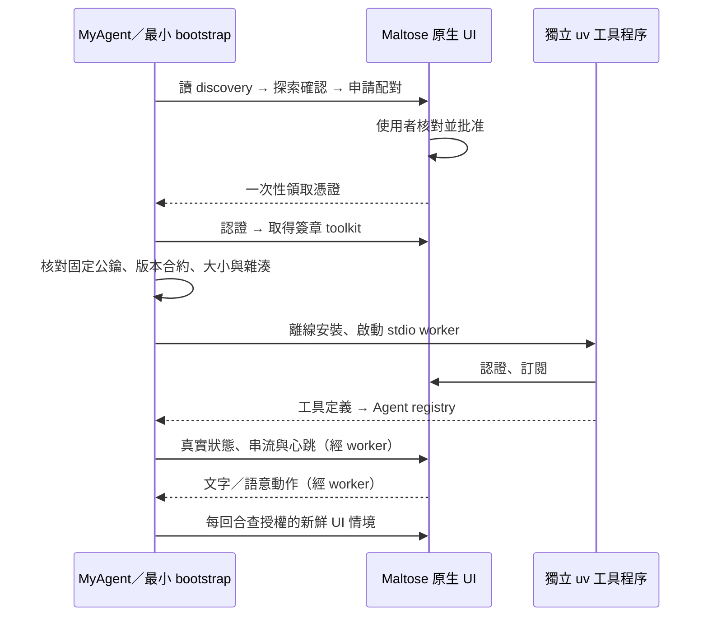

# MyAgent 與 Maltose UI 使用方式

這一版已接上 `/Users/Marvin/Workspace/MyAgent`，使用原生 Host 0.4.0；MUP 協定仍為 v0.3。

## 現在怎麼用

1. 開啟 `dist/Maltose UI Host.app`。
2. 在 MyAgent 目錄用原本的方式啟動，加上 `--maltose`：

   ```sh
   cd /Users/Marvin/Workspace/MyAgent
   ./start --maltose
   ```

   原本 `./start` 仍會啟動它既有的 Web UI。Maltose 本身不依賴 Web UI；要用單獨的 Agent 啟動方式，也可對原有 `uv run … myagent` 加同一旗標。不要為此改既有語音、模型或識別設定。

3. Maltose 會出現「MyAgent 請求連接」。與 Agent 日誌中的 `verification_code` 核對後，按「允許並記住」。批准涵蓋該代理的連接、自己建立的畫面與驗證過的工具套件安裝。
4. 第一次由 uv 在獨立環境安裝工具，之後重用。需要 PATH 上已有 uv 和可用 Python 3.12；不會下載 Python、不接觸 MyAgent 的模型依賴。
5. 連上後可在原生面板看到待命、聆聽、模型推論、工具及播報狀態、對話與進度，並輸入文字指令。讓 Agent 顯示內容後，可移成獨立視窗；對圖表縮放、框選，再問「分析我選的這段」。每回合會自動讀取授權的 focus／selection／viewport。

MyAgent 原本的說話者身分驗證仍有效；未知使用者不能因 UI 已配對就讀私人情境。文字輸入沿用 Agent 當下的身分流程，不會自動把輸入者視為已驗證使用者。UI 存在本身也不表示所有畫面已分享：其他代理的文件與選取內容需要原生「跨代理分享」另行授權。

如要以設定檔啟用，可在既有 MyAgent TOML 加入以下段落；本次開發沒有修改使用者的實際設定或憑證：

```toml
[maltose]
enabled = true
agent_id = "agent.myagent"
name = "MyAgent"
```

## 自動完成的流程



不需要輸入 port 或複製 token。Host 換 port 或重啟後會重新探索，憑證仍有效就自動接回。多個 Host 同時出現時不隨機選擇，可使用 `maltose_connect(instance_id=…)` 指定。每個不同 Agent 應使用自己的 agent_id。

## 新 Agent 的最小接入

可共用 `packages/bootstrap/maltose_bootstrap`（純標準函式庫）。MyAgent 已將此 bootstrap 與固定公鑰放在 `myagent/ui/_bootstrap`；其餘工具由 UI 派送，不把整個 SDK 裝入 MyAgent 環境。

框架 adapter 需要一次接上：`on_tools` 將工具 schema 與 `bootstrap.call(name, arguments)` 代理登錄到框架，`on_notification` 將原生輸入送入該框架的工作佇列；將真實 runtime 事件送給 `bootstrap.runtime`，每回合用 `bootstrap.context` 取得情境。`Bootstrap.start()` 負責背景探索、批准等待、安裝及重連。完整參考實作為 MyAgent 的 `myagent/ui/bridge.py`。

這不是讓模型自行改程式或執行安裝命令；沒有框架 registry 接口的 Agent，仍需先加一次 adapter。

## 常見情況

| 畫面／狀態 | 處理方式 |
|---|---|
| 找不到 UI（unavailable） | 開啟新版 app；Agent 每 5 秒重試。不要查固定 port。 |
| 等待批准 | 在原生 UI 核對代碼並批准；120 秒後過期，需要明確重試。 |
| Agent ID 已存在 | 不會替陌生申請輪替憑證。使用原本的 Agent 快取，或換不同 agent_id；若要重配，先在原生 UI 明確撤銷舊身分。 |
| authorization_required | 憑證已失效／撤銷或身分不符。要重新授權時，先停止 Agent，撤銷該 ID，再移走該 Agent 私有目錄中的 credentials.json 後重新啟動；不要把檔案內容貼入對話。 |
| 安裝失敗 | 檢查本機 uv、Python 3.12 與磁碟空間。先前環境保留，不會執行未通過驗證的 wheel。 |
| 簽章失敗 | 不會安裝；bootstrap 的固定公鑰必須與正式 toolkit publisher 相符，不能改成信任 UI 臨時送來的公鑰。 |
| 無法讀私人畫面 | 檢查 MyAgent 的既有人類身分驗證，以及 Host 內該代理的分享 scopes。 |
| 超過 15 秒未收到心跳 | UI 顯示逾時並停止顯示舊活動為正在執行；模型內部思考內容不會憑空生成。 |

探索目錄：`~/Library/Application Support/MaltoseUIHost/discovery`。Agent 私有狀態：`~/Library/Application Support/MaltoseAgentBridge/<agent_id>`。後者的 `credentials.json` 為 0600 檔案；Host 使用 Keychain。請勿分享這些憑證。

本機發行仍是 ad-hoc 簽章、未公證。真實麥克風、實際模型服務及使用者正式批准的完整日常流程尚未手動驗收；已執行的隔離測試與限制見 [驗證報告](verification/agent-integration-report.md)。

## 啟動時找不到 myagent-kws310

這是在 Maltose 接入前的喚醒詞服務錯誤。2026-10-29 已將暫存環境改為 MyAgent 專案內持久的 `.venvs/kws310`，保留原模型與主環境。若日後遺失，可在 MyAgent 執行 `uv run --no-sync python dev/tools/setup_kws_runtime.py` 重建。實際模型載入／健康／reset 與回歸結果見 [KWS 修復報告](verification/kws-startup-fix-report.md)。
