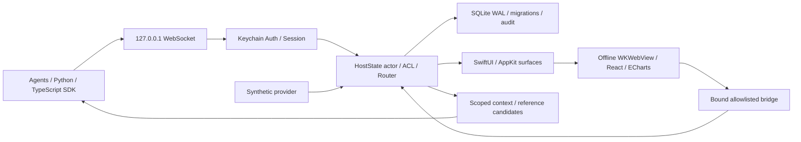

# 架構

`HostState` 是所有指令、ACL、文件版本與 context 更新的串行化權威；交易中失敗會回復記憶體狀態與 SQLite。對持久副作用，idempotency 結果與文件在同一筆交易提交。每個 surface 的 placement / userOverrides 與 document 分離。

`SurfaceManager` 定義穩定 node ID 的文件樹與原子 patch。`ContextCollector` 接受 AppKit focus 與有綁定來源的 renderer 事件。`ContextStore` 於每次讀取重新依 scope 過濾；`ReferenceResolver` 僅輸出結構化候選與證據。`EventRouter` 具送出前 ACL 重驗、上限與缺口同步。

AppKit 以 surface_id 管理 NSWindow，SwiftUI 呈現 Workspace 與本機可信任的 credential / grant 控制。WKWebView 不保存 cookie、不載入網路資產、不執行代理程式。所有元件由封閉 enum 描述。

`MaltoseHost` 是無 GUI 的相同核心服務，用於 SDK 與部署診斷；它沒有第三方應用程式感知能力。Overlay kind 保留但回傳 unsupported。
