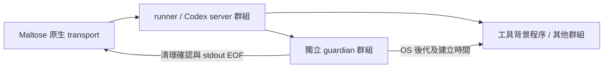

# Codex 宿主／server 崩潰與背景程序收尾

日期：2026-11-01。原生完整桌面／語音驗收仍進行中，本報告涵蓋程序、協定與隔離 fixture 的真實服務。

## 重現與修補

本機 Codex 0.155.1／既有 gpt-6-astra 在隔離專案以終端工具啟動 Python，寫入 PID 與 heartbeat，持續 300 秒。PID 檔另由 OS 父子關係、cwd、指令及建立時間核對；沒有把模型提供的 PID 當作任意終止權限。

- 原宿主 SIGKILL：已完成回合但背景工作存活、以及回合仍 inProgress 的兩種情境，Codex 自身 EOF 清理通過。
- **原 server 群組 SIGKILL 失敗**：背景工具在另一個群組，忽略 SIGHUP 時仍持續寫入 heartbeat。十秒觀察後 server 已退出，但背景程序未退出。實驗最後以已捕捉的自有 PID／建立時間清理，沒有把清理後結果當成原測試通過。
- 修補後的相同 server 群組 SIGKILL 通過；另將宿主保持存活、只終止 server 群組的獨立情境也通過；包含獨立 guardian 在內的所有捕捉程序退出，heartbeat 停止。恢復同 thread／worktree 不重放背景工作，原回合仍是 completed，最後封存自有 fixture thread。
- 修補後宿主在工具仍執行時 SIGKILL 也通過；恢復同 thread 得到 interrupted，不被改成 completed，沒有發送新的模型 prompt 或重送工具。

第一次驗證腳本的暫存路徑定位偏移已修正；該次僅建立隔離 fixture，已封存 thread 並把證據移入專案私有 cache。一次恢復腳本曾在 daemon reader 尚未退出時結束 interpreter；雖然 OS 清理結果通過，該次程序退出為 134，未列為完整成功。已改為排空、join reader，後續整個驗證程序以 0 退出。

## 延用現有生命週期



runner 在執行 CLI 前先建立 guardian；它以 50ms 間隔觀察 OS 後代，保留已換群組／重新掛父的存活身分。清理逐 PID 比對建立時間，不對其他獨立程序廣泛送訊號。它與 server 不同群組，server 被強制終止後仍能收尾。

Guardian 持有私有 stdout 的 EOF lease，所有已追蹤後代結束後才送收據並退出。原生 transport 以當次 root PID／隨機 token 核對收據；清理失敗或 token 不符保持錯誤及 Maltose 暫停，不能默默換一個 scope。此 metadata 不進入模型情境、產品對話或面板狀態。

啟動前失敗且從未 exec CLI 時，runner 在確認自己的啟動資源停止後送 startup_aborted；原生層只在尚未完成初始化時接受，讓修復 CLI／依賴後可重試。已就緒的 server 不能使用此捷徑。

協定損壞後只繼續處理有來源的收尾收據，其他舊事件不再執行。Guardian 的結束分隔使截斷／超限資料後仍可重新找到收據。parser 只搜尋新片段，避免每次讀取都重掃累積的大 frame；超限 frame 丟棄到下一分隔，16 MiB 上限保持。

正常交回仍先使用 app-server 的 backgroundTerminals list／clean／重查；guardian 補足 server 不可回應時的 OS 收尾。回合結束後發生的清理失敗也透過既有 onIssue 保存並呈現，不讓 UI 只停留在等待意圖。

## 依賴與驗證

新增 codex extra 明確宣告原環境已有的 psutil 7.2.2。164 個 lock 套件版本完全相同，原有套件來源及 artifact hash 保留；registry metadata 補上一個 lancedb Windows wheel，未更動 macOS 已有 artifact。受管理 main 116 個／KWS 66 個套件前後逐項相同；開發環境仍為 117 個套件。沒有更換語音、ML、模型或全域 Codex 設定。

Python 守護與驗證工具六項聚焦通過；完整 Python 393 項、0 failures／errors／skip，包含五項 Docker 實際整合。原生協定／收尾聚焦通過，包括壞 token、清理失敗、啟動修復、截斷及 17 MiB 超限資料後的確認與重試。後者曾重現反覆掃描累積資料的延遲，修正後該雙情境案例於 0.430 秒通過，未放寬限制或延長測試等待。最終完整 Swift 141 項、0 failures、15 桌面 skip，包含實際 Main／Codex 雙模型交接。第一輪 140 項及補齊閒置錯誤呈現後的聚焦十二項亦通過。

可重現的真實服務驗收：

```sh
runtime/.venv/bin/python runtime/dev/tools/verify_codex_parent_crash.py --fault server-crash
runtime/.venv/bin/python runtime/dev/tools/verify_codex_parent_crash.py --crash-at running-tool
```

工具使用既有 CLI 帳號／實際模型，會產生服務用量，不自動批准人員要求。私有 cache 保存 thread／PID／診斷；公開結果只保留狀態摘要。

## 證據範圍

這些是真正的 CLI／工具程序與隔離宿主，包含原生 transport 的控制測試；沒有把它們說成已實際強制退出整個原生 App 視窗。Guardian 的所有權範圍來自已觀察的 OS 後代；任意外部 daemon 不在本輪證據內。完整原生 App 崩潰、真人語音／多任務／裝置矩陣，以及 Codex 桌面專案／目前聊天重新定位仍按 [主計畫](../../plans/maltose-unification-and-codex.md) 驗收。

**0.7.0／build 11 已重新封裝**，142 個 bundle／126 個 runtime 檔案與當前來源相符。舊路徑別名暫時移除期間，strict 簽章、獨立 cwd 匯入（包含 lifetime／runner）與兩項既有憑證值掃描均通過，之後立即還原別名。沒有啟動正式 Agent／麥克風，Finder 仍待驗收；build 10 保留私有備份。詳見 [build 11 結果](lifetime-build11-results.json) 與 [故障結果](codex-lifetime-results.json)。

解鎖後的最新完整 Swift 回歸為 141 項、0 failures、0 skip；build 11 已由 Finder 啟動並完成正式主 Agent 真實文字回覆。這新增桌面證據，不把既有無 UI 宿主崩潰當成完整原生 App 崩潰驗收。詳見 [當前桌面驗收](build11-desktop-acceptance.md)。
