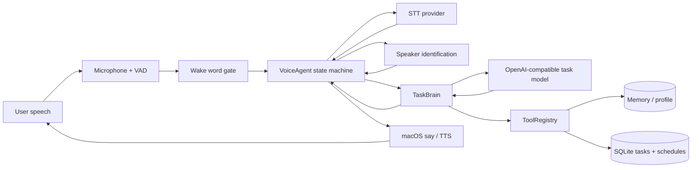
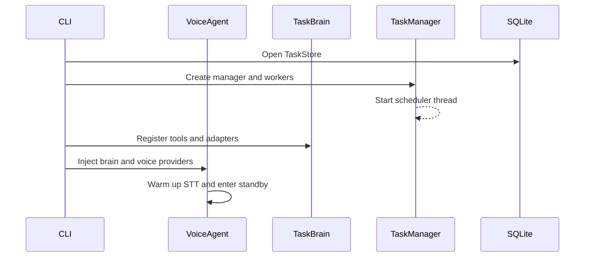
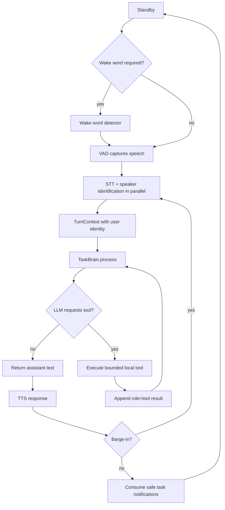
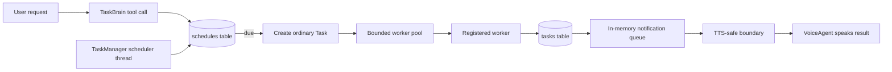

# Maltose Python Runtime Architecture

> 本文保留匯入時的 Python Agent 架構說明；下方 `MyAgent`、`myagent/` 與舊啟動名稱屬來源歷史。現行套件為 `maltose/`，設定優先使用 `maltose.toml`，舊名稱經明確相容層讀取。App 程序、共用面板及 Codex 協作的現行架構見 [產品架構](../docs/architecture/README.md)，進度與驗收見 [產品整合計畫](../plans/maltose-unification-and-codex.md)。本頁不能替代原生 App 的啟動說明。

## Overview

MyAgent is a local voice interface wrapped around a bounded reasoning and task
orchestration layer. The voice layer owns microphone input and speech output;
TaskBrain owns model calls, tools, memory, schedules, and task coordination.

## Runtime startup

`myagent/agent/cli.py` builds the runtime from `myagent.toml` and CLI
overrides. In `taskbrain` mode it creates the following objects:

1. `TaskStore` opens the SQLite task database.
2. `TaskManager` starts its bounded worker pool and scheduler thread.
3. Built-in workers are registered, including `codex_readonly`, optional
   `web_research`, and `assistant_message`.
4. `TaskBrain` receives memory, profile, task, search, MCP, and environment
   capabilities.
5. `VoiceAgent` connects the brain to STT, speaker identification, microphone
   events, and TTS.

## Normal conversation flow

The computer's local date and time is injected into the system context on
every turn. `get_current_datetime` is therefore mainly needed for a requested
non-local timezone or an explicit fresh reading. Other environment tools are
called only when the model decides they are relevant.

## Task and schedule flow

Supported schedule recurrences are `once`, `daily`, and `weekly`. Schedule
timestamps are normalized to UTC while the configured IANA timezone is retained
for calculating recurring occurrences. `assistant_message` is the worker for
spoken reminders; it returns `input.message` unchanged so the assistant does
not rewrite the reminder text.

There are two separate statuses to keep in mind:

- A schedule becomes `completed` when it has triggered and created its ordinary
  task.
- The generated task becomes `succeeded` or `failed` after its worker runs.

## Capability boundaries

| Capability | Owner | Persistence | Side-effect boundary |
| --- | --- | --- | --- |
| Conversation context | TaskBrain | In-memory, bounded | Cleared at standby/session end |
| Long-term memory | MemoryStore / LanceMemoryStore | Local DB | Explicit `remember` only |
| User profile | UserProfileStore | Local DB | User-scoped access |
| Tasks and schedules | TaskStore | SQLite | Worker registry only |
| Web search | WebSearchProvider | Not persisted by default | Read-only, bounded results |
| Location | EnvironmentTools + optional macOS helper | Not persisted | Explicit tool request and OS permission |
| Internal/external IP | EnvironmentTools | Not persisted | External lookup can fail without crashing agent |
| MCP / Skills | Capability adapters | Adapter-defined | Explicitly registered tools |

## Current gaps and next work

- Durable task recovery and notification replay after process restart are not
  complete. SQLite state survives, but in-flight execution and pending
  notifications need recovery semantics.
- Schedules that cause external side effects still need an explicit confirmation
  policy before creation or execution.
- MCP reconnect handling and configured Skills exposure remain on the roadmap.
- Proactive notifications currently wait for a safe VoiceAgent TTS boundary;
  they must not interrupt active speech.

## Key source locations

- `myagent/agent/cli.py`: runtime assembly and configuration wiring
- `myagent/agent/agent.py`: voice state machine and TTS boundaries
- `myagent/agent/taskbrain.py`: model loop, tools, session context, notifications
- `myagent/agent/tasks.py`: SQLite task/schedule state and worker execution
- `myagent/agent/environment.py`: date/time, location, and IP tools
- `myagent/voice/`: microphone, VAD, wake word, STT, speaker, and TTS adapters
