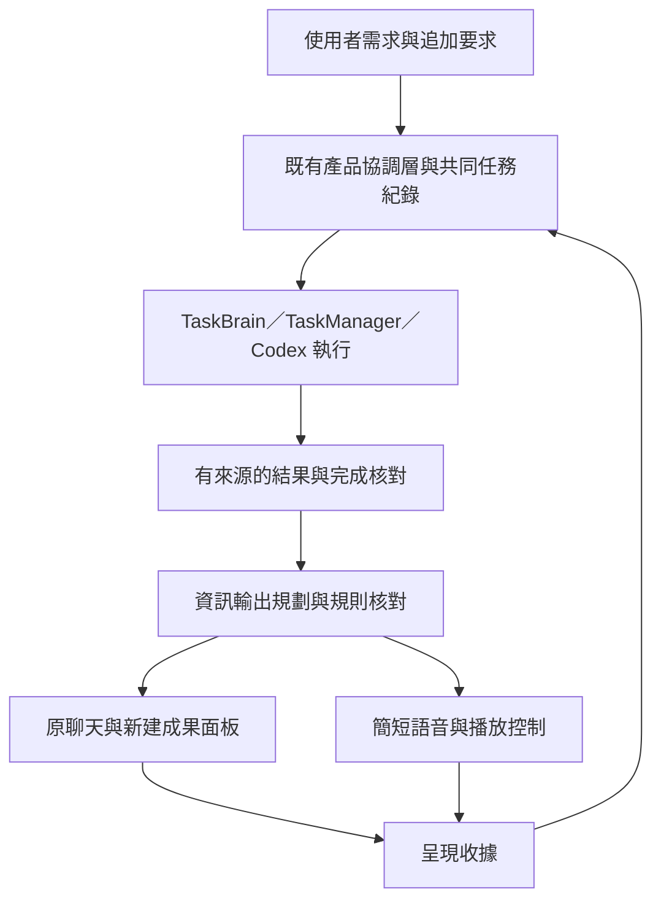

# Maltose 任務工作流與資訊輸出層

## 2026-11-02 工作區恢復與工作面板行為（build 21）

依最新指示，首次使用預設開啟形象、聊天與「工作日誌」；日誌放在既有格線右下格，保留聊天／形象原尺寸。後續啟動依 `workspace/session.json` 恢復最後開啟的面板、穩定 ID、螢幕配置、選取／模式、格線縮放、日誌位置、筆記與瀏覽器網址。成果文件／圖表內容繼續由原對話成果 journal 恢復，不把所有歷史成果重新開啟。這一版沒有新增其他文件／圖片／流程圖內容的通用自動保存；原存檔入口不變。失聯螢幕回退到可用螢幕，無效紀錄保留原檔並回到預設面板。

形象與聊天不能關閉，限制位於共用 manager、Agent 指令與原生 policy 入口，回覆 `protected_panel`，不觸發授權流程。工作日誌仍可關閉／移動，已關閉的日誌不因下次啟動強制重開。工作區紀錄與正式協作 writer 共用 App 生命週期，取得協作 writer 後才啟用保存；UI-only 不讀寫人員工作區。

任務投影載入未完成任務或任務狀態改變時主動建立單一進度面板；已完成／取消任務不觸發，手動關閉後相同狀態快照不反覆開啟。自動建立保留目前選取與模式。進度與日誌的滾輪事件在全局格線交由面板內容處理，聚焦／側欄主面板亦可獨立捲動，顯示系統捲軸；Control＋滾輪仍縮放格線。

聚焦原生 **29 項通過**，41.594 秒，涵蓋雙啟動恢復、固定面板、歷史成果開啟範圍、失聯螢幕、錯誤／連結紀錄保留、任務自動開板、三種模式的實際 NSScrollView 與格線事件路由。完整原生 **292 項全部通過、無 skip**，923.428 秒，包含 GUI／真正配置 Main／Codex／Docker；前版偶發的公開研究收尾本輪直接通過，沒有重跑或改動核對策略。Python 來源與 build 20 完整 577 項通過基線逐檔一致，這批未重跑 Python。封裝結果見 [build 21 驗證資料](../../../docs/verification/workspace-session-build21-results.json)。原生新測試首版的型別預設值編譯錯誤、日誌初版落在左下格均已修正，保留首跑紀錄。

已封裝獨立 `dist/trials/build21/Maltose.app`，Release 59.65 秒；嚴格簽章、140 份 runtime 來源一致、私密設定檢查與獨立匯入通過。UI-only/windowed 實際啟動 2 個視窗，恰三個預設面板、未開啟進度板，正常退出；沒有啟動正式 Agent 或收音。正式 build 15 與試用 17／18／19／20 執行檔均保持原值，沒有 commit 或正式替換。

此批只處理使用者追加的工作區與工作面板需求；進階恢復保持 deferred，未擴充任務核對或模型策略，正式 App 切換仍由人員驗收。

## 2026-11-02 行為紀錄與圓環任務進度（當前試用批次）

使用者確認新增兩個透明內容面板：行為紀錄顯示可理解的 Agent 動作摘要；進度面板同時顯示多個任務與可收合的樹狀子任務，使用圓環進度，完成時補滿一圈後轉成勾勾，任務名稱保留。沿用現有工作區的選取、放大、跨螢幕與一般面板常設權限。

- [x] 兩種 singleton 面板接入既有 catalog、建立／關閉／重開、read_panel 與 get_user_view；內容無底色。
- [x] 以共用 ProductTask／Codex 執行引用投影任務樹，不新增另一個任務 writer。
- [x] 增加有版本與來源核對的步驟進度回報；可保存至既有任務 store。回報只影響呈現，整項完成仍依原成果核對。
- [x] 既有 Main 事件、背景工作狀態與 Codex turn／plan／item 產生行為摘要；不展示工具參數、底層輸出或思考文字。
- [x] 圓環可確定進度／無法估算／暫停／失敗／完成；已完成任務預設收合。行為紀錄沿用 30 秒閱讀保護。
- [x] 完成聚焦與完整回歸、實際 SwiftUI 渲染及 build 20 封裝；完整原生的一個研究收尾案例首次失敗、同來源補驗通過，詳見下列紀錄。

本版先提供觀察與任務定位，控制動作仍沿現有聊天／任務入口。任務及 Main 步驟進度沿既有 store 恢復；行為紀錄標示「本次啟動」，最多保留 500 筆；Codex 細步驟依本回合實際 plan 事件，重啟尚未收到計畫時顯示已知執行狀態與不確定圓弧。進度不依時間灌水；群組按葉節點計數，保留核對／交付節點，不能以模型自報全部步驟完成冒充整項完成。

驗證：Python 完整 **577 項通過**（含 Docker）；原生完整 **284 個案例中 283 通過，1 個既有公開研究收尾案例失敗**，同一來源單獨補驗 1 項通過（9.134 秒）。失敗回覆把新增成果面板誤當作修改舊板，此路徑只呼叫 set_task_plan／read_web_page，沒有使用新增進度工具；保留其原回覆與失敗記錄，不宣稱完整原生首跑全綠。新面板與真實進度傳輸共 9 個案例在完整回歸均通過，另有聚焦 29／9 項直接證據。

build 20 已交付 `dist/trials/build20/Maltose.app`；Release 55.30 秒，簽章、140 份 runtime 來源一致性、隔離匯入及 UI-only 雙窗口啟動／退出通過，實際啟動快照含 agentActivity／taskProgress。未啟動主 Agent、未收音，正式 build 15 與試用 17／18／19 的 executable SHA256 均未改變。實際 SwiftUI 的執行中／完成截圖使用隔離虛構測試資料。詳細 [本批驗證報告](../../../docs/verification/agent-work-panels-build20-results.json)。

下一步：由使用者試用這兩個面板；真人語音／手勢與正式切換仍待驗收，研究完成核對的偶發誤判保留為已知問題。進階恢復維持 deferred，不擴充本批。

## 2026-11-02 最新面板權限決定（優先於歷史規則）

依使用者「面板給 Agent 最大自由度，除本地文件增刪改外跳過授權」的新指示，Main 與 Codex 共用常設的面板讀取／操作權限。建立、聚焦、選取、切換、移動、關閉及面板內內容修改不再檢查逐次人員授權、聲紋或二次意圖模型；新成果預設新增只是呈現偏好，Agent 可依需要重用既有面板，並遵守人員明確要求保留的內容。這取代下方歷史紀錄的「只有明確更新才可操作舊面板」硬性限制。

本地檔案建立、覆寫、刪除仍依原 FileService／檔案權限機制；流程圖匯出仍保留既有匯出同意與檔案版本核對。面板內容編輯不等於修改磁碟原檔。真正的任務暫停、取消、過期來源與 Main／Codex 執行權交接仍有效；操作回執保存、讀回及去重繼續處理傳輸結果不確定，均不增加人員授權步驟。Memory／KDB 身分不因面板權限而改變。

此次只修正實際阻斷的面板授權問題，進階恢復／呈現維持 deferred。聚焦原生 20 項、完整 Python 574 項／原生 275 項全部通過，無 skip。build 19 已封裝至 `dist/trials/build19/Maltose.app`；簽章、140 份 runtime 來源一致性、隔離匯入及 UI-only 雙窗口啟動／正常退出通過，未啟動 Agent 或使用麥克風；正式 build 15 與試用 17／18 保持原樣。詳細 [本批驗證結果](../../../docs/verification/panel-autonomy-build19-results.json)。真人語音驗收與正式切換仍未完成，未提交本批修改。

## 文件狀態

- 狀態：`in_progress`；build 18 已交付；本批面板常設權限修正已封裝 build 19，進階恢復與額外呈現維持 `deferred`。
- 最後更新：2026-11-02（Asia/Shanghai）。依使用者最新要求「先打包一版，接著收斂你的優化」調整優先順序；下方歷史測試與失敗記錄保留。
- 交付來源：回到原生面板操作證據批次的已驗證產品程式，完整基線 Python 574／原生 280 通過；新 cold bootstrap 與後續 cold-ready 失敗測試已隔離，不包含於 build 18。
- 執行入口：[主計畫入口](../../../plans/task-workflow-and-presentation.md)。責任邊界：[ADR 005](../decisions/ADR-005-task-workflow-and-presentation.md)。本文件是本功能的唯一詳細計畫。

## 本輪收斂範圍（優先於下方歷史排程）

1. 有完整、可比較的半年數值時，主動新增原生圖表；保留來源、不同調查方法、月份精度與缺值。主回答漏圖時沿原資料補圖，不虛構數值。
2. 說清楚欠缺的來源、核對或工作；只有需要人員決策才提問，避免用籠統「待確認」代替具體原因。
3. 完整文字與連結留在畫面，語音維持簡短摘要。新成果預設新增，面板操作沿最新常設權限；聊天閱讀保護與 Codex 交接沿既有規則。
4. 交付可試用 App，核對 Release 編譯、簽章、內含 runtime、核心回歸及隔離 UI 啟動；保留正式 build 15 與試用 build 17，不自動啟動正式 Agent。

本輪以可試用成果及已知限制交付。後續只處理實際試用中的阻斷問題；不再因假設性的邊界追加功能或反覆重跑已通過且未變動的全套。冷啟 scope、新的跨插問恢復、未知操作人工核對、排程來源／持續更新許可、更多自主面板類型及暫停 Codex 的短語音列為後續獨立工作。真人聲音／手勢與正式切換仍需實際驗收，不以自動測試冒稱已完成。

進階恢復的九份程式／測試與原文件保存在 `.cache/deferred/cold-worker-scope-20261102/`，包含檔案 SHA256 及 cold-ready 的真實失敗紀錄；這是可恢復的開發快照，不是產品資料。原工作樹只回退本 agent 的該批改動，未 reset 或覆蓋其他變更。其完整 577／284 第一輪通過及後續失敗均保留於 [歷史資料](../../../docs/verification/cold-worker-scope-results.json)；不把移出功能當作修復其失敗。

## 目標與已確認需求

1. 改善麥芽糖對任務的規劃、接續、委派、成果核對與收尾，讓使用者知道需求進展及下一步。
2. 增加統一資訊輸出層，由麥芽糖依結果決定文字、文檔、圖表、流程圖、圖片或瀏覽器的呈現組合。
3. 完整答案與口頭摘要分開；語音以簡短結論、重要限制或需要使用者決定的事項為主。網址及過長內容留在畫面。
4. **成果面板預設新增；Agent 可自主操作既有面板，不再另取授權，並遵守明確的保留要求。**「更新一下股價折線圖」在目標唯一時更新原圖；一般「幫我看股價走勢」另開新圖。
5. 保留既有單一聊天、@codex 收件人、真實暫停／交回、身分、Memory／KDB、檔案政策及 30 秒聊天閱讀保護。

這些是同一產品內的邏輯模組，先共用現有主模型與程序。簡短對話走快速流程，多步驟工作才建立計畫，複雜成果才編排多種呈現。

## 現有基礎與缺口

| 既有元件 | 可沿用能力 | 本次補齊 |
| --- | --- | --- |
| `TaskBrain`、`TaskManager`／`TaskStore` | 有界計畫、相依工作、排程、worker 狀態與通知 | 產品需求與子工作關聯、要求版本、完成證據、接續與收尾 |
| `AgentSessionCoordinator`、`CodexTaskStore` | 持久 conversation／task／thread、收件人、輸入送達、執行權交接 | 中立的產品任務紀錄，關聯 Python 工作與 Codex 執行；保留既有恢復與去重 |
| `review_collaboration` | 主 Agent 唯讀整理追加要求與成果，再確認新意圖 | 以相同結果合約交付具體結論、限制及下一步，並區分報告與已驗證證據 |
| `VoiceAgent._respond_to_input`／`_speak_stream` | 聊天事件、串流切句、render-ahead、播放與打斷 | 語音只接核准的口頭內容；完整回答不再直接成為預設朗讀內容 |
| 共用面板介面、Python FileService、原生 model | 建立與操作面板、MainActor 修改、私有 stdio | 統一呈現規劃、所有 Agent 寫入入口的新增／更新規則與交付收據 |
| `MarkdownDocumentModel` | Markdown 排版、表格、程式碼與唯讀顯示 | 目前主要讀取內建範例；補受控的任務結果載入、標題與來源資訊 |

計畫盤點時未執行應用測試；開始實作後的分階段直接證據集中於 [本功能驗證紀錄](../../../docs/verification/task-presentation-integration-report.md)。歷史證據見 [build 15 報告](../../../docs/verification/chat-autoscroll-report.md)：聊天聚焦 10 項通過，完整 Swift 148 項有 1 個全螢幕失敗案例；2 項 skip 後來補驗通過。不能以此宣稱本功能或完整整合已通過。

## 架構與狀態擁有者

產品層任務真相由既有原生協調／持久 store 邊界管理。可從 `CodexTaskStore` 抽出中立的產品任務儲存模組，但只保留一個 writer 與版本化遷移。Python `TaskStore` 繼續管理自己的工作、排程及身分政策；Codex 繼續管理 thread／turn。以 ID 關聯並透過既有 IPC 同步，避免三處各自改寫同一份產品任務狀態。UI 是共同任務的投影，不新增獨立任務真相。

主模型提出計畫、成果與呈現建議；程式核對真實狀態、要求版本、許可及交付結果。使用者與工具／Codex／網頁的文字來源保留，外部文字不能變成使用者授權。鍵盤輸入仍不能取得已驗證的 Memory 身分。

輸出層使用既有面板核心及 FileService，檔案以受控內容或 artifact 引用傳遞；不讓模型任意提供原生讀檔路徑。成果、語音摘要與呈現中間資料不自動寫入 Memory 或 KDB。正式資料格式遷移依原規則備份、單 writer、可回復。

### 三份合約與交付紀錄

| 合約 | 必要資訊 |
| --- | --- |
| `ProductTask` | task／conversation／parent ID、目標、要求與版本、步驟／相依、當前 owner 與執行引用、完成條件、證據引用、阻礙、下一步及待確認意圖 |
| `TaskOutcome` | outcome／task／turn ID、要求版本、完成／部分／需輸入／失敗／取消狀態、結論、完整內容／artifact、來源與驗證證據、未解事項、需要的決策 |
| `PresentationPlan` | schema／presentation／outcome ID、內容世代、文字與視覺配置、每項 create 或明確授權的 update、焦點政策、語音內容／模式／預算 |
| 交付紀錄 | 結果已保存、面板建立／內容套用／目前可見、聊天送達、語音排隊／播放／完成／中斷／失敗；各項有穩定 ID 與獨立狀態 |

通知與成果交付沿用持久 outbox／journal，保存後才確認接納；啟動時先核對已送達狀態，不依賴會在重啟時遺失的記憶體通知佇列。

所有新增欄位須有版本、相容讀取、容量限制及錯誤行為。完整成果與摘要可依同一份已核對資料生成，不強制每句再呼叫一次摘要模型；精簡不能改變結論、刪掉必要限制或虛構成果。模型格式錯誤時保留已取得的真實內容，降級為簡短說明與完整文字，不朗讀原始 JSON 或整篇舊答案。

## 任務規劃、銜接與收尾

1. 接到需求先辨識目前任務、承接／修改／新需求及已具備的授權。一般一步回答直接處理；多步驟任務保存目標、必要完成條件及少量可執行步驟。
2. 沿用原有有界工作與批准政策。在已授權計畫內銜接一般步驟；需求不明、範圍變更、批准或新決策才向使用者提問。不得以新工作流放寬原限制。
3. 委派時攜帶目標、限制、完成條件、已完成成果、要求版本及下一個回收點；使用者追加要求先記錄並更新版本，再核對進行中的工作。
4. worker 成功、工具成功及 Codex 回合結束分別記錄。只有符合當前要求版本與完成條件、證據足夠時，產品任務才能完成；不能把「執行成功」直接等同「滿足需求」。
5. 結果不足則保持部分完成／待驗證／需輸入，明列已完成與缺口。取消／停止不宣稱撤銷已發生的副作用；無可信證據時保存不確定狀態，不盲目重做。
6. 收尾交付成果、重要限制與具體下一步，關聯原目標及追加要求。簡單回答不強制追加確認問題；@codex 交回仍遵守原約定：主 Agent 確認新意圖前不恢復舊工作。
7. 子工作完成後回到所屬產品任務，依原先授權與 gate 判斷能否續做；不能為了「更自主」自動解除 Codex 交接暫停或重啟 held 工作。

### 需求延續與授權判斷

需求分類使用當前任務、最新要求及真正使用者輸入；worker、Codex、網頁或文件提供的建議只作資料。主模型提出分類，原生保存實際來源與版本，不能由模型產生另一份「使用者已要求」。

| 新輸入 | 任務處理 | 可接續範圍 |
| --- | --- | --- |
| 補充同一目標、修正條件 | 同一產品任務追加要求並升版本；既有成果保留原版本 | 依最新條件核對後接續，舊版結案與待播語音失效 |
| 明確提出另一個目標 | 新產品任務，保留原任務與未完成事項 | 不藉新工作自動恢復 held／cancelled 的舊工作 |
| 只要求計畫、評估或討論 | 完成條件限於該計畫／評估／討論 | 不把提出實作步驟當成已授權實作或部署 |
| 短確認或指涉不明 | 先依可辨認的待確認問題／原目標解析 | 只有影響目標、許可或更新對象而無法判斷時才提問 |
| @codex 直接輸入 | 關聯當前開發任務與新要求版本，保留原始人員文字 | Main 維持真實暫停；交回時確認新意圖，不恢復舊工作 |

應有正反例：同任務補充不遺失舊條件、新任務不污染原任務、「寫個 plan」不觸發實作、外部建議不增加許可、@codex 交回後未確認即不能派發舊工作。模型判斷不確定時保留事實與具體待決策事項，不猜測取得授權。

產品任務的執行、成果核對、交付與執行權是分開的狀態。呈現或 TTS 失敗只重試必要的交付，不重新執行已完成的修改、查詢或其他工具操作。追加要求到達時，舊版本的收尾與待播語音失效，但已完成成果仍保留其版本與來源。

## 面板規則：預設新增，明確要求才更新

### 新增與更新

- 每一份新的成果發表預設 `create`，即使同一任務、同一主題、相似標題或已有選取面板，也不能自動改寫既有面板。
- 同一發表的串流、分段填入與重連重送共用 presentation ID，只能延續它新建立並綁定的面板；這是一次建立的完成過程，不是往後可重用所有舊成果的權限。後續新問題、新結果或新發表預設另開。
- `update` 必須源自真實使用者的明確要求，例如「更新這張圖」「把這張圖改成週線」。目前選取可協助解析「這張」，本身不構成更新授權。
- 目標唯一時綁定穩定 panel ID 及允許的操作；有多張可能的圖、目標消失或指涉不清時先釐清，不覆寫另一張圖。模型不能只以 `update=true` 自行宣稱已獲授權。
- 「更新一下」只授權該次更新；「持續更新這張圖」才可建立明確範圍、停止方式及生命週期的持續更新任務，不隱含永久背景更新。
- 更新保留其餘內容與可保留的使用者視圖設定。流程圖有未儲存修改時沿用原保護；不以輸出層繞過。
- 同發表串流也要核對內容 revision；使用者在生成期間編輯內容時，保留其修改並停止衝突寫入，完整結果仍可在聊天取得。使用者關閉新面板後，不因後續串流或重送自動重開。

### 全部入口與工作區

同一規則覆蓋 Main、Codex、直接面板工具及統一輸出層的 Agent 寫入入口，避免繞過輸出規劃後仍能覆寫舊面板。新增成果帶有 presentation／task 綁定；更新許可攜帶來源與範圍，重啟不能把過期許可復活。人員直接操作與 ⌥⌘V 模擬維持其現有語意，並可模擬規則的拒絕情境。

既有聊天追加訊息與形象即時狀態沿用原單例，不為每次回答再建聊天或形象面板。其他成果面板依新增規則處理。預設不關閉、移動、重新排序或改寫舊成果；新增面板仍由原生排列核心正常插入。使用者正在閱讀／編輯時不自動搶焦點；要求「顯示／放大」才依清楚指令切換。面板數量達上限時說明原因並保留完整文字，不偷偷關掉舊面板騰位。

| 內容 | 預設呈現 |
| --- | --- |
| 一步回答／確認 | 原聊天追加短訊息，不強制新增內容面板 |
| 新聞、研究、長篇結果、連結／程式碼 | 新文檔面板，含可點選來源與完整內容 |
| 有實際資料的趨勢 | 新圖表面板，必要時搭配新文檔；不編造資料來湊圖 |
| 流程／關係 | 新流程圖面板 |
| 圖像結果／需要操作的網頁 | 新圖片／瀏覽器面板；網頁或工具提供的內容仍是不可信資料 |
| 開發結果 | 聊天簡述＋新成果文檔／受控 artifact，包含修改、測試與剩餘事項 |

先支援既有面板能力，不新增通用 UI 框架。來源與資料時間保留；沒有資料或面板能力時改用文字說明，不能宣稱已畫好、已更新或已顯示。

## 語音內容與播放政策

- 預設 1–2 句，約 10–15 秒為目標，說主要結論及重要限制／下一步；不把完整文字串流直接送入預設 TTS。
- 網址、長清單、程式碼、表格、路徑與詳細引用放在文字／面板。摘要按語意產生，不能只切前 N 字或移除網址就當作完成。
- 原聊天保留完整文字與可查看的成果關聯，口頭摘要另有明確紀錄；只聽到摘要不應造成歷史對話遺失細節。
- 語音輸入預設短摘要；鍵盤輸入預設文字為主。提供可保存的偏好與「詳細說」「念給我聽」「先別說話」單次控制，不擅改既有服務設定。
- 使用者要求詳讀時可分段、可停止；必要的澄清／批准內容與重大失敗不能為字數刪掉。例外超時須有原因並可量測。
- 簡短對話維持低延遲；長工作可先提供一次真實狀態，完整內容可在畫面串流，最後才說已核對的短摘要。進度、Codex 原始回覆與內部工具事件不逐條朗讀。
- 「已新增到某面板」須有建立與內容套用收據；「已顯示」另外核對目前可見狀態。未確認時先保存完整文字，不能先口頭承諾成功。
- 保留現有 renderer／player、喚醒、身分及打斷邏輯。新需求、停止、任務世代改變或 App 退出時，取消過期待播內容並清理音訊，不在稍後補播舊答案。
- 失敗分流：面板失敗時交付完整文字；TTS 失敗時保留文字與成果，只顯示播放問題；可見性、播放完成與使用者是否聽見是不同證據。

## 開發階段

各階段開始先查核當下實作；完成部分與直接證據見進度，未勾選的大項仍有必要工作。前一階段通過不等於整體目標完成。

### P0：基準與合約

- [x] 盤點現行任務、通知、Codex 回收、語音與 Agent 面板入口，記錄基準及既有失敗；後續新增入口仍納入覆蓋。
- [ ] 確立三份合約、單一狀態擁有者、schema 版本、容量、要求世代、錯誤及重啟語意，更新 ADR。
- [ ] 建立測試 fixture 與時間／播放量測方式，列出正式資料備份及漸進啟用／回復方式。

### P1：完整文字與短語音，第一個可用版本

- [ ] 引入完整結果與口頭內容分流，覆蓋串流／非串流回答及背景通知，保留舊 brain／CLI／Web UI 相容 adapter。
- [ ] 補文檔 model 的受控結果載入，經共用面板核心建立新成果面板；實現 presentation ID 與交付確認。
- [ ] 實作語音預算、輸入來源預設、詳讀／靜音、錯誤降級、打斷及過期內容取消；簡單回答不增加強制二次模型呼叫。
- [ ] 在隔離資料驗證長新聞／連結／程式碼完整顯示而只短講，面板失敗不重做任務。

### P2：任務銜接與結果核對，第二個可用版本

- [ ] 在既有協調與 store 邊界落實產品任務、要求版本、計畫／工作引用與中斷恢復，不合併或繞過個人 TaskStore 權限。
- [ ] 建立小問題快速流程、多步驟完成條件與證據核對、部分成果／阻礙及待決策狀態。
- [ ] Main／Codex 委派與使用者追加要求都關聯同一產品任務；具體收尾、去重與最新要求優先。
- [ ] 完成單一聊天中的真實委派、直接互動與收尾；保持原自主暫停／新意圖確認，不自動恢復 held 工作。

#### P2 接續批次與完成邊界

- [x] 背景接續第一條接線：完成後無工具綜整、原授權內補證據／補工作、worker 失敗承接、最多八次接續後具體提問；已生成結果崩潰恢復及過期交付拒絕有直接證據，內部接續不偽造人員輸入。其餘通用承接與恢復仍列下方未完成項目。
- [x] 一般前景第一條有界接續：真正交付的 partial／已知讀取失敗依原授權補做，鍵盤與未知語音不假造 owner；純計畫完成及具體 needs_input 停止，生成後恢復不重做。其餘失敗類型、明確 retry／人工核對與獨立問答後承接仍待補齊。
- [x] 獨立問答後前景接續第一條路徑：保存問答分類當時的原任務版本，答案真正交付後才回到同一原授權；多個後續步驟與生成後重啟已驗證，原要求與 Memory 身分不變。
- [x] 背景 worker 原成果跨獨立問答第一條路徑：等待真正答案送達、重新核對 writer 來源、同一原任務／owner／attempt 交付；鍵盤不恢復 speaker，遺失 ACK／較舊成果晚到走持久 followup。已生成 continuation 跨插問及全部未知狀態仍未完成。
- [ ] `deferred`（已移出 build 18）：新 runtime 未識別身分的 worker 成果 bootstrap 第一條路徑：由原生當前對話／真實最新輸入選取 worker／attempt 範圍；pending body 與已生成 continuation 的 SIGKILL／fresh store 恢復通過，無新 input、舊 owner 恢復或工作重跑。未知 running work 及已生成成果跨插問不包含在此完成範圍。
- [ ] 補已生成接續成果跨插問、其餘尚未送達背景成果與全部失敗／未知狀態的可理解處理；沿用輸入分類，避免錯掛需求或擅自取得開發授權。
- [ ] 補齊排程建立來源、已開始執行的未知狀態核對與恢復入口；明確呈現已發生事實、剩餘事項及可安全重試的範圍。
- [ ] 接上 Codex 暫停中的短語音回顧；以同一個有效問題／要求版本檢查文字與播放，新輸入到達即取消舊交付；確認新意圖前維持 Main 暫停。

- [x] 輸入分類第一條接線：原生／語音 Main 新輸入先與舊任務分開，透過同模型工具循環明確分類；原生核對當前人員來源、版本與不可重綁，真實模型的全新計畫案例已驗證。一般前景第一條持久交付／有界接續已有驗證，獨立問答後承接與其餘恢復仍待補齊。

本批結果生成、驗證與交付分開持久保存。generated 結果重啟後只恢復交付，不重做模型或工具；running work 且沒有結果時保持 uncertain，再核對事實。正文與獨立核對文字在真正寫入前都要檢查版本、執行權及新輸入，不能先顯示過期結案再撤回。

#### 進行中：一般前景成果的持久承接

| 接線 | 必要行為 | 直接驗收 |
| --- | --- | --- |
| 前景生成到本機保存（已接線） | 保存完整結果、不可變工具回執、原始人員輸入／身分來源、要求／計畫版本及交付意圖後，再請 App 接納；不用假 worker 通知或已辨識 owner 填滿現有 FK | 在保存後、UI 接納前崩潰，恢復相同內容與 ID；模型／工具不重跑 |
| 原生真正發表（已接線） | Main 正文與獨立核對文字都先有可核對來源，在 journal／面板 writer 寫入前檢查最新輸入、執行權與版本；已保存有效正文不因後來新要求被抹掉 | 新輸入到達每個發表邊界時，過期寫入被拒絕，完整事實仍可追溯；lost ACK 不重複開板 |
| 交付與成果核對（已接線） | 真正已保存的完整計畫／報告可以成為交付來源，避免只因未讀檔而永遠 awaitingEvidence；其內容仍需對照人員完成條件，不能把有文檔當作已實作功能 | 純規劃可按規劃需求驗證；模型只說完成、缺實作／測試、格式錯誤與超限仍不能冒充完成 |
| 接續與執行來源（第一條路徑已接線） | 接到前景部分成果／失敗才依原授權續做；保存原執行來源與當前授權來源，不把舊 attempt 改貼新版本；未知 work 不自動重跑 | 鍵盤／已識別及未識別語音、重啟、新 owner、明確 retry、取消／held 均有正反例；鍵盤不取得 Memory 身分 |
| 獨立問答後的承接（已送達前景成果第一條接線） | 在該問答已交付且來源／執行權允許時，判斷能否回到原授權任務；新目標與 Codex 新意圖確認沿用現有邊界 | 問答不污染原條件；仍可正常收回原任務成果；不恢復 cancelled／held 或尚待確認的新意圖 |

一般前景來源、保存、交付與有界接續的第一條路徑已驗證；自主圖表與具體語音提示沿用 build 17。當前來源預設啟用 foregroundResultVersion／foregroundContinuationVersion，試用 build 17 仍是先前封裝版本。通用承接、未知狀態核對與真人驗收未完成；相容 adapter 不可讓前景成果借用最近 Main／worker 的 owner 或引用。

### P3：自主面板編排，第三個版本的功能部分

- [x] 主回答漏圖的第一條持久呈現規劃：原答案先保存，來源表格選欄位／分組，程式帶入真實數字、缺值與註記；已生成意圖恢復只重送，不重做原任務。其餘資料來源／輸出類型與通用編排仍待補齊。
- [ ] 根據結果與已授權的工作區資訊選擇呈現，完善文檔／圖表／流程圖／圖片／瀏覽器路徑。
- [ ] 在全部 Agent 寫入入口核對預設新增、明確更新授權、穩定目標與同一發表的串流寫入範圍。
- [ ] 驗證多張圖、無選取、目標消失、使用者編輯、面板上限、跨窗口、焦點及 30 秒閱讀保護。

### P4：整體恢復與桌面／語音驗收

- [ ] 測試每個關鍵交付點的崩潰、取消、逾時、重複事件、亂序及重啟，不重做寫入、不重複開面板、不播舊答案。
- [ ] 執行下方全部產品場景；隔離實際 Main／Codex 流程與真人語音證據分開記錄。
- [ ] 驗證身分、Memory／KDB、原始文件、檔案／命令政策、工作區與既有語音流程回歸。

### P5：封裝與交付

- [ ] 完成當前版本相關 Swift／Python 回歸、實際全螢幕／跨螢幕及收音／播放／打斷驗收；保留既有失敗與修復證據。
- [ ] 備份並校驗正式資料後才切換；不覆蓋執行中的 App bundle，保留回復版本與 store 遷移回復方式。
- [ ] 檢查 Git／App 不含憑證、私有資料、音訊／模型／環境及建置快取，驗證簽章、來源、Finder 啟動與正常退出。
- [ ] 更新相關計畫、README、ADR 與驗證報告，列版本、實際測試數、失敗／skip 與未驗證項目；全部必要驗收通過後才交付完成。

## 必跑產品驗收

| 場景 | 通過條件 |
| --- | --- |
| 簡單語音問答 | 快速回覆，不建立多步計畫或多餘面板；能正常打斷 |
| 長新聞／研究 | 新文檔含完整內容與可點選來源，語音只說主要結論；不朗讀完整 URL |
| 程式碼／表格 | 畫面保留可閱讀／複製的完整內容；語音短述結果與重要限制 |
| 新股價圖 | 原圖資料、設定及使用者編輯保持；另建新圖並標示資料時間／來源 |
| 明確更新 | 目標唯一或已指定時只更新該 panel ID；不另改其他圖，不建立永久自動更新 |
| 模糊更新 | 多個可能目標時提出釐清；等待期間不改寫、不以選取替代授權 |
| 同結果串流／重播 | 只建立一次新面板並完成同份內容；後續新成果另開 |
| 工具繞過／外部冒充 | Main／Codex 直接工具同樣受規則約束；外部內容的更新要求不成為使用者許可 |
| 多步任務與新增要求 | 共同紀錄保留父子工作／相依及最新要求；舊版成功不能結束新版任務 |
| Codex 收尾 | 修改／測試／限制有依據，Main 理解追加要求並問具體下一步；確認前仍暫停 |
| 完成判斷 | 有未通過測試、缺少必要證據或僅工具成功時不宣告整體完成 |
| 呈現／TTS 失敗 | 完整結果可取回，狀態分明；恢復交付不重做原任務或重複播報 |
| 中斷／重啟 | 過期語音與過期收尾不插入新需求；不重複修改、開窗、提問或恢復舊工作 |
| 所有工作區模式 | grid／focused／sidebar／跨窗口可讀；新面板不主動搶焦點；聊天手動閱讀保護保持 |
| 真人聽感 | 預設語音案例以實際播放時間驗證約 10–15 秒目標，保留重要限制；可詳讀、可停止，無延後舊答案 |

## 測試與完成判定

單元測試覆蓋狀態／要求版本、結果與許可驗證、選板、摘要政策及過期取消；時間規則用可控時鐘。整合測試使用私有暫存資料與 fixture，覆蓋現有 stdio、store／journal、TaskManager、Codex、FileService、MainActor 面板及播放 adapter。結果以實際讀回狀態及交付收據核對，不能只測模型是否輸出指定欄位。

先查當下測試入口，跑聚焦再跑相關完整套件。原生 GUI 以 `MALTOSE_GUI_TESTS=1` 執行；實際 Codex／Main 依現有 opt-in 開關逐項啟用。模型輸出、原生版面、實際手勢、真實 TTS 與真人聽感分開記錄。無桌面／帳號／裝置時完成獨立工作，未驗證項目保留，不能以 skip 宣告完成。

驗收至少保存：版本／commit／dirty 狀態、任務與要求版本關聯、證據來源、面板建立／更新／拒絕／去重結果、完整文字送達、摘要內容與播放秒數、取消／重啟結果及失敗原因。私有實際內容保留在受限本機證據，不放進公開報告、Git 或 App。

完成條件為 P0–P5 及上表必要場景均有對應版本的直接證據。原 M0–M7 的既有全螢幕失敗及其他未完成項目持續追蹤；不得為取得通過移除案例、放寬身分／批准、改用覆寫舊面板或退回整篇朗讀。

## 非目標

重做面板 UI、新建通用 Agent 框架、換模型／STT／TTS 引擎、自動整理／關閉舊面板、預設長期背景更新、將所有成果匯入 Memory／KDB，以及自動放寬 Codex 執行權均不在本輪。CLI／Web UI 保持可用，不要求本輪重做其產品介面。

## 目前進度

2026-11-01：完成來源盤點與計畫／提案 ADR，未修改執行程式、正式資料或 App。8 份文件的 69 個本機連結、Markdown fence／行尾檢查及 `git diff --check` 通過；沒有為計畫撰寫重跑應用測試。下一步設定執行目標後從 P0 核對現況開始。

### 2026-11-01 第一條輸出接線（進行中）

已新增 `AnswerResult` 的版本化完整內容／口頭摘要合約，沿用 TaskBrain 同一模型回合產生結果；格式不符時保留原始完整內容，限制與失敗不得在精簡時遺失。Native VoiceAgent 接上結果處理，聊天保留全文、鍵盤來源預設靜音，語音依預算選用摘要。CLI／Web 仍走既有相容路徑。

原文檔 model 已具備受控結果載入；新增 runtime-only `publish_document`，建立新文檔且保留原內容與焦點。同發表重送沿用面板、不同內容拒絕、已關閉面板不重開。此去重目前限同一 App 執行期，尚不是持久交付；沒有將它宣稱為 P4 完成。

修改前基準：既有 TTS pipeline 1 項與 Swift 聊天／合約 8 項通過。新 Python 聚焦 7 項通過。受限沙箱的完整 Python 414 項出現 4 failures／12 errors／5 skip，日誌保留；明確包含 sysctl／localhost 的 Operation not permitted。允許必要存取並啟用 Docker 後完整 Python 415 項全數通過，36.526 秒。原生結果面板／聊天／合約聚焦 10 項在允許 WindowServer 後通過、無 skip；最初受限執行有兩項 WindowServer skip，不能算桌面成功。

上述為初輪證據；後續完整 Swift 151 項出現正常退出及原生全螢幕失敗，細節與保留日誌見驗證紀錄。正式 App 仍是 build 15，未封裝／切換本批來源。

### 2026-11-01 全文串流與單次語音控制（進行中）

已補 presentation v1 能力協商及真正跨程序結果交付；結構化結果仍經原串流工具循環，頂層 full_text 可逐步送往原聊天，完成後核對全文／限制。補設定檔保存 auto／summary／mute 偏好與預算、單次詳讀／靜音、同身分來源的上一份結果朗讀、長文分段、新輸入取消及 TTS 失敗保留文字。尚未新增設定 UI，背景通知／Codex 收尾尚未全部統一。

最新聚焦原生 13 項及真實程序生命週期 5 項通過；語音修整後聚焦 62 項、完整 Python 430 項通過，包含 Docker、無 skip。正常退出清理握手的終止訊號問題已修正，正常測試採正式 3 秒期限、強制終止維持 0.1 秒；串流／控制及摘要修整兩版完整 Swift 各 151 項，均只有既有全螢幕案例的 7 個斷言失敗，正常退出及新輸出／真實 Main／Codex 案例通過。

公開 fixture 的真實模型首次因摘要降級丟失測試資料限制而失敗，保留證據。現已改為更明確的短摘要要求與必要時一次無工具修整，兩輪實際驗證均保留完整正文與重要限制；一般回答一個原模型回合，另以刻意過長摘要實際驗證修整分支，沒有重跑原任務。語音時長目前是估算及獨立 renderer 證據，不代表真人播放／聽感通過。

其後繼續背景通知分流、共同產品任務、全部 Agent 更新許可、持久恢復及真人驗收。P0–P5 仍不完整，各大項不因局部測試通過而勾選完成。

另補原通知路徑的單次靜音／明確打斷保護；待處理人員輸入或退出時不 drain 通知。此保護尚不是完整背景輸出／持久交付。聚焦 Python 63 項通過，最終完整 Python 431 項與原生聚焦 12 項通過、均無 skip，詳見驗證紀錄。直接核對正式 dist App 仍為 build 15；沒有部署或新 commit。

下一批已盤點全部 36 個模型工具的讀取、內容寫入、檔案及視圖操作邊界，不能只依模型提示執行預設新增政策。持續補齊背景成果的持久交付、共同 ProductTask／TaskOutcome 與完成證據，再落實所有入口的更新許可、恢復及正式真人／封裝驗收。

### 2026-11-01 背景成果持久交付與恢復（部分落地）

`TaskStore` 新增 additive 的通知 outbox，worker 終態與待交付內容同一交易寫入；舊歷史成功工作不回填通知，避免重播。通知／準備結果均有 v1 合約及穩定 ID，保存後才進入原生交付。完成通知使尚未交付的舊進度失效；無法呈現的內容保留原始資料且不 ACK，不擋住同批後續有效結果。

原生以可選 `resultDeliveryVersion=1` 協商 runtime-only 的 `deliver_result`，舊 App 保留原相容路徑。先將全文與發表意圖同步寫入既有聊天 journal，再建立固定 ID 的新文檔並保存套用回執。重啟恢復同一文檔，重送不重複插入聊天；使用者關閉的 tombstone 跨重啟有效。若無法保存關閉紀錄則不誤報關閉。新需求的面板仍另開，不修改舊內容／焦點。

Agent 取得 `chatStored` 回執才 ACK outbox；語音先保存 claim，重啟後的回報僅恢復文字／成果，不補播舊語音。閒置原生文字模式也能察覺背景結果，不必等下一則人員訊息。取消與晚到結果保留取消狀態，記錄已發生影響，工作仍在 drain 時拒絕重跑同一 attempt；取消回報僅留文字。CLI／Web 相容 adapter 的恢復提示不重念舊答案。

聚焦 Python 88 項、原生 18 項通過；完整 Python 443 項通過，36.810 秒，含 Docker、無 skip。完整 Swift 156 項、無 skip，212.245 秒，只有既有全螢幕案例的 7 個斷言失敗。真實分離程序案例讓 worker 在 Agent 閒置後才返回，原生成功保存但刻意丟棄回執，重建 App 與 runtime 後確認工作只執行一次、聊天／成果各一份。此 fixture 的已驗證身分由測試提供，並非真人聲紋驗收。所有日誌與中途失敗見 [驗證紀錄](../../../docs/verification/task-presentation-integration-report.md)。

這是 P1 背景路徑與 P4 恢復的一個實際切面，不能等同整個階段完成。下一階段優先實作原生 store 邊界的共同 ProductTask、要求版本、Python／Codex 執行引用及完成證據；再接 Codex 收尾輸出與所有 Agent 更新許可。前景回答在原生接納前的 runtime 持久保留、超限／非法 Unicode 的受控 artifact 降級、全部故障矩陣、偏好 UI、真人語音與正式封裝仍待完成。

最後的長來源測試抓到空摘要被「仍有待確認事項」狀態提示誤認合格的問題，初次聚焦 89 項及完整 444 項各有 1 個失敗，證據保留。修正後聚焦 89 項通過，1.737 秒；目前完整 Python 444 項通過，34.225 秒、含 Docker、無 skip。最新原生聚焦 18 項通過，13.836 秒。

真實主模型另以 26,057 字元公開虛構背景原文、空摘要及末尾來源限制驗證：一次無工具摘要呼叫，保留原文／結果 ID／未查核限制，口頭內容估計 8.25 秒，沒有重做原任務或使用個人 Memory。這仍是模型與輸出政策證據，沒有播放、收音或真人聽感證據。

### 2026-11-01 共用產品任務與跨程序關聯（部分落地）

原生 store 在同一 writer／快照新增 v1 ProductTask、原始輸入、要求版本、計畫歷史、執行引用、證據與成果；整份 store 使用 schema 3，相容讀取 schema 1／2，第一次寫入前保存原始位元組的 0600 備份。新增要求與任務關聯一同保存，不修改原始目標或把舊成果升級為新版本。舊失敗證據不因追加要求消失；僅有 worker／模型回報不足以結案。

Main 經協商的私有 workflow v1 保存語音來源、讀取分頁任務摘要與設定有界計畫。模型不能指定執行身分或冒充人員輸入；原生鍵盤規劃不取得 Memory／個人工作身分。未知聲紋的不同語音回合不共用 owner；已識別語音依同一 profile 核對。主 Agent 回答與 Python 成果保留原始執行版本，結果／證據／終態一起保存，衝突重送不留下局部修改。

Python 背景工作先建立私有 pending rows，原生接納執行引用並寫回 SQLite 後才派發。額外的持久 dispatch_ready 條件與關聯同一交易開啟，避免既有依賴完成時繞過尚未確認的派發。回執不明時整批 held、不自動重跑。observer 限當次 create_plan 呼叫，不讓排程或相容入口錯綁上一位使用者。通知同時要求全文與 workflow 回執才 ACK；語音 claim 與舊結果恢復規則保留。

Codex 直接互動與模型委派關聯同一產品任務；每回合攜帶目前版本與該委派範圍，原始聊天作者不變。Codex 摘要不包含未委派的 Main 要求、私人步驟、其他 worker 內容或其他子任務。停止將停止要求、待送訊息延後與產品 held 一起保存；單純交回 Main 不解除舊工作。明確新的人員工作可開始新回合，但不使 Python held jobs 自動復活。

實際分離程序已驗證：主 Agent 先規劃再接追加要求；兩個真正相依 Python workers 在 host 關聯後執行，回到同一根任務；Codex 兩回合沿用根任務、要求版本與暫停／意圖確認。語音來源由受控 fixture 提供，沒有收音或真人聲紋證據。原生聚焦 22 項與最新完整 Python 452 項通過。完整原生 169 項仍有既有全螢幕案例的 7 個斷言失敗，無 skip；最新聚焦重驗及中途失敗另見 [驗證紀錄](../../../docs/verification/task-presentation-integration-report.md)。

**本批完成時 P2 尚未完成**：當時可信完成核對只有 host store API 與狀態測試；下一批的前景自動核對見下節。不能把待驗證任務永久停在 awaitingEvidence 就算達標。需求延續／修改／新任務分類、排程來源與每次 retry attempt 的完整引用、所有恢復／故障點及具體 Codex 收尾輸出仍需補齊。後續再完成全部面板更新許可、偏好 UI、真人語音、全螢幕與正式封裝；P0–P5 大項維持未完成。

### 2026-11-01 前景 Main 自動成果核對（部分落地）

ToolRegistry 在真正工具返回後捕捉有界不可變觀察，只接受本次 Main 執行緒、輸入、要求與計畫版本；其他背景執行緒不繼承 Main 身分。只收錄支援核對的 FileService／隔離命令／面板與時間回執，不複製 Memory、KDB、個人 TaskStore 或全工作區感知的工具內容。完整檔案／面板讀回及可辨識的實際測試命令回執分別成為來源／成果／驗證觀察。一般命令返回 0、搜尋片段與模型／worker 自述不直接成為完成證據。檔案／面板的已知後續修改會使較早讀回失效。

原生保存全文與 Main 成果後，使用同一配置主模型進行一次無工具語意核對；沒有合格證據、資料不完整、超限或執行尚未結束時不增加該呼叫。核對必須覆蓋全部目前條件並引用實際觀察；原生再次核對要求／計畫版本、未解失敗、全部未確認執行與實際證據，再原子保存 assessment。模型不能自行提供可信核對，結案不由口頭文字或單一成功回執決定。

核對結論與具體剩餘事項另存於聊天，同份核對重送沿用穩定 ID；原成果與新建面板保留。部分／需輸入結果與核對失效不直接播報「全部完成」，明確要求詳讀時也會先說明原回報仍有核對限制。讀回之後才追加的人員要求會使舊版核對失效，不重跑原工具或原任務。最新任務摘要向 Main 保留核對結論與 remaining，支援後續承接。

背景回報新增 runtime-only delivery_origin，沒有共用任務引用的舊排程／通知不會誤掛最近 Main 任務；舊 prepared v1 回報恢復時也依實際通知來源修正，模型不能透過最終 JSON 指定該欄位。新核對欄位為可選的版本化資料，舊 client 未協商 workflow 時不發送新操作。

直接證據包含受控原工作循環＋真正 FileService／容器工具，以及實際配置主模型的語意核對：本機來源足夠時結案、檔案自稱測試通過／夾帶改寫核對指令時拒絕結案、真正隔離測試執行後根據本次回執結案。另有追加要求競態、過期讀回、原生拒絕虛構 witness、保存後重送與短語音／詳讀限制測試。所有測試數與歷次失敗見 [驗證紀錄](../../../docs/verification/task-presentation-integration-report.md)。

**P2 仍為 in_progress**：目前自動核對覆蓋前景 Main 的上述入口；Codex SDK 命令／差異與 Python worker 的完整驗證引用、背景完成後的有界自動接續、尚缺事項的下一步與阻礙判斷仍需接通。排程建立來源、retry attempt、需求延續／修改／新工作分類、關鍵點崩潰恢復、前景接納前的 outbox 仍未完整。P3 所有更新授權／多面板編排、偏好 UI、真人收音／播放與正式封裝也未完成。全螢幕本輪有通過證據，但未修改相關程式，之前的間歇性啟用失敗仍需實際啟動條件核對。

### 2026-11-01 Codex SDK 證據、暫停中核對與新文檔收尾（部分落地）

SDK item/started 保存不可變的要求／計畫版本、執行引用及命令；實際終態的完整測試輸出、exit code 與 worktree 必須相符，才成為測試證據。未辨識命令及缺少 started 的歷史資料保持 unknown，複合命令不能只依 exit 0 升格；已知後續 fileChange 會使較早測試失效。開始事件早於 submit ACK、同回合追加要求及晚到回執均已覆蓋。

Codex 結束後，控制器以實際差異、唯讀來源專案基準及 SDK 證據呼叫一次無工具主模型核對；不進入 Main 的 Memory／工具循環或恢復 held 工作。模型收到明確可引用 witness ID 清單，原生仍檢查目前要求、失敗及執行狀態。無效引用直接拒絕，不靜默刪除或放寬完成判斷。主模型的下一步 review 與產品 assessment 使用各自的持久快取。

收尾回顧現在可保留完整 Markdown／連結與獨立短摘要，經 host 核對問題仍有效後接原 deliver_result；新回合新增面板，舊結果保留。未知 ACK 後重啟並重試只恢復同一交付，不重跑 SDK turn、不重複模型 review、不重複聊天／文檔；過期問題在發表前拒絕。短摘要已生成，但 **Codex 暫停期間尚未接安全播放佇列，不算語音完成**。

真實已登入 Codex 在隔離專案修正 add，實際執行原有三項 unittest；配置的真實主模型引用本次測試與差異後結案，來源檔案／HEAD／index／status 基準保持，Main 仍 paused。這是真實開發／核對證據，沒有真人收音或聽感。最新聚焦原生 17 項通過，84.842 秒；完整 Python 465 項通過、無 skip，43.357 秒，包含 Docker。完整原生回歸及中途失敗見 [驗證紀錄](../../../docs/verification/task-presentation-integration-report.md)。

接續仍需 Python worker 驗證觀察與背景自動承接、需求分類、排程／retry 來源、前景接納前 outbox、暫停中安全短語音、全部面板更新許可及正式驗收。既有部分實作先補驗，不重做 UI；P0–P5 大項維持未完成。

完整回歸進一步抓到主模型把最終差異快照誤認成測試後的新修改，以及長 witness ID 抄錯。已明列觀察順序、快照／來源基準的意義、有效 witness 與部分核對的欄位規則；長 ID 使用當次請求短引用、嚴格驗證後還原原鍵。較早要求版本的晚到修改也納入核對，不因版本過濾而遺失。新增短引用往返／原始資料不變／舊測試失效反例，Python 聚焦 10 項與完整 467 項通過；受影響的真實模型／面板／聊天聚焦 4 項通過，完整原生結果另記驗證紀錄。沒有讓模型誤判成為通過條件。

最新完整原生 185 個案例中，184 個通過，僅既有全螢幕案例失敗（7 個失敗斷言）、無 skip；本批 Codex／Main、交付／重啟及其餘回歸均通過。補協作啟用的 UI-only fixture 後，4 項工作區聚焦仍有同一全螢幕案例失敗；啟用請求 allowed=true 但 App 非 active。唯讀系統狀態實際顯示螢幕鎖定，已請使用者解鎖後重驗，不能宣稱完整回歸全通過或所有歷史全螢幕問題已修復。正式 App 仍是 build 15，沒有新 commit／部署。

### 2026-11-01 背景工具證據、每次執行引用與聚合核對（部分落地）

新增獨立 workerEvidenceVersion=1 協商；既有 TaskStore additive 的 task_attempts 與原生 pythonAttempt 保存每次真正執行的來源。派發前先保存準備狀態，host 同一交易將原 job 綁定轉為已接納並登記 running attempt，原生 ACK 與本機保存後才執行 worker。完成／錯誤、不可變工具觀察與通知同一 SQLite 交易保存。真正重試使用新 execution ID，保留舊失敗；僅 ACK 不明且尚未進入執行時，明確重試可重送同一 ID。開始過但狀態不明的工作仍要求 reconciliation，不盲目再跑。

實際 worker 呼叫使用隔離的 context collector；ToolRegistry 在返回邊界複製受支援回執，別的執行緒、Main 或私人 Memory／KDB 不混入。WebResearchWorker 另記 provider 的真正搜尋結果與 snippet 範圍，不冒充全文讀取。模型／worker 字串不能自填可信 observations；64 項／完整度預算溢出保留標記。每次返回依原要求／計畫版本保存，追加要求不替舊執行換版本。

當全部工作已返回且有有效證據時，主模型核對當前結果與同 owner／task／版本中已確認送達的完整成果；原生仍獨立核對 witness、失敗與全部執行狀態。核對文字未知 ACK 只重送交付、不重做模型或 worker。原始全文保留，口頭收尾依 host 的 completed／partial／needs_input 狀態，不能在完成核對後仍把泛用「待核對」提示當結論，也不能朗讀未核對的成功自述。進度通知不再冒充終態 pythonResult。

真實分離程序的兩個相依 worker，經真正 FileService 讀回兩份完整來源，兩份成果各建新文檔；配置主模型合併已交付成果後完成。反例仍讀回兩份檔案，但只有檔案自稱三項測試通過、沒有測試回執時，真實主模型拒絕結案並留下具體缺口。原工作規劃與語音身分為受控 fixture，沒有真人收音／聽感證據。聚焦原生 18 項與最新完整 Python 478 項通過，相關完整原生結果及中途失敗見驗證紀錄。

本批最後完整原生 **189 個案例全部通過、無 skip**，304.721 秒；包含真正 Main／Codex、Docker、新背景正反例、未知 ACK 與全螢幕／跨螢幕回歸。先前鎖定期間的失敗保留；本輪 AppKit 實際確認原生 System Space 全螢幕，不代表已完成真人手勢、正式 Finder 啟動或所有歷史問題的原因核對。正式 App 保持 build 15，沒有新 commit／部署。

**P2 仍未完成**：下一步是完成後主動綜整／有界自動接續與失敗承接，不能把部分結果永久留在 awaitingEvidence 就算完成。需求分類、排程建立來源、已開始 attempt 的崩潰 reconciliation、前景接納前 outbox、暫停期間安全短語音、全部面板更新許可、多面板編排、偏好 UI、真人驗收與正式封裝仍待處理。

### 2026-11-02 背景有界接續、主動綜整與交付恢復（部分落地）

continuationVersion=1 私有協商在產品預設啟用；舊 client 不收到新操作。背景完整成果與核對文字保存後，VoiceAgent 既有主循環從持久佇列取出接續，沿用相同 owner、產品任務、輸入及要求／計畫版本。不是新增使用者訊息，也不寫入個人 Memory。已核對完成走無工具綜整；未完成且可在原授權內補做時走原 ToolRegistry 有界循環；真正需要選擇／新許可或達八次接續上限才提出具體問題。

原生單一 writer 先接納接續與真實 execution，工具前後檢查新輸入、版本、執行權、停止與取消。get_task_workflow 讀取保留 continuation ID，後續實際觀察不會錯掛先前 Main。完整結果、工具回執先保存，再交付；文字與獨立 assessment 皆在真正寫入前檢查當前來源。新 @codex 輸入可阻止尚未派發的工具或過期文檔；已發生操作保留，不宣稱回滾。

受控案例已驗證主動回顧、補讀第三份來源、worker 失敗後由原授權 Main 補讀且不重跑 worker、重送／遺失 ACK、不偽造要求、八次接續後提問。配置的真實主模型實際選擇 FileService 工具、合併三份完整來源後核對完成。這不是只有無工具評審，也沒有用真正使用者的私人文件。

另以實際 fixture runtime SIGKILL 驗證：原生保存結果後、ACK 之前崩潰，完整關閉並重建原生 store、面板與 runtime；原 generated 結果恢復為同一份面板／聊天，worker count=2、補讀 count=1、接續模型 count=2，沒有重跑原工作。此身分恢復為受控測試來源，不代表真實聲紋恢復驗收。已開始 work 但沒有生成結果仍保持 uncertain；只讀 finalize 可重新生成，重啟不自動補播舊內容。

最新針對崩潰恢復、過期 assessment、真實模型接續與 ACK 遺失的原生聚焦 4 項通過、無 skip，34.098 秒；Python 接續 8 項通過，0.029 秒。第一輪完整 Python 486 項與原生 197 項通過，這是最後新增 assessment 發表守門／恢復案例之前的基準；最終當前來源回歸及中途失敗以 [驗證紀錄](../../../docs/verification/task-presentation-integration-report.md) 為準。

**P2／整體仍未完成**：一般前景接續與需求分類、排程來源、running work 未知狀態核對／人工恢復入口、前景接納前保存、Codex 暫停中的短語音、多面板編排與全部更新許可、偏好 UI、真人語音／手勢及正式封裝仍有工作。下一批按 [入口的接續批次](../../../plans/task-workflow-and-presentation.md#接下來的實作批次) 執行；先保全已驗證結果，不重做 UI。

當前來源最後完整 Python 486 項通過、無 skip，48.671 秒；完整原生 199 個案例中 198 通過，只有既有全螢幕啟用案例失敗（7 個斷言）、無 skip，368.231 秒。所有新增接續／恢復／過期核對案例與真實 Main／Codex 通過，仍不能宣稱全套或整體目標完成；詳見驗證紀錄。正式 App 仍為 build 15，沒有新 commit／部署。

### 2026-11-02 輸入範圍分類與原任務保全（部分落地）

發現前景新訊息原先會自動綁定未完成任務，造成獨立問答也被追加為舊任務的完成條件。新增 inputScopeVersion=1 私有協商與 set_task_scope，沿用同一個 TaskBrain 工具循環，記錄已保存人員輸入的 continueTask／newTask／standalone 分類。讀取舊任務不等於綁定；新多步任務另建，獨立問答不寫產品任務，明確延續才以原始人員文字追加版本。新協定下，未分類不能透過 set_task_plan／pythonPlan 改寫原計畫。

原生記錄分類，拒絕舊人員輸入、過期版本、已承諾來源重綁，以及用分類／計畫解除 held。新任務建立只綁定自己的原輸入，不再掃入其後未分類訊息。Codex 直接追加沿用既有明確收件人與來源；Main 新輸入不擅自變成其原任務追加。舊 client 未協商時保留既有 read／setPlan 相容流程，runtime 不提供不受支援的新工具。

內部接續不提供 set_task_scope；新的人員輸入即使沒有追加舊任務版本，也使舊接續的工具／發表權失效。計畫／討論範圍由真正人員需求決定，工具分類不新增開發許可。實際配置主模型已對獨立規劃要求使用新任務，保存計畫並交付；原任務逐欄保持、沒有 Codex／Python 開發工作、隔離來源專案只保留原始 fixture。此案例不是人工收音／聽感，也不代表一般前景自動接續已完成。

聚焦與完整回歸結果集中於 [驗證紀錄](../../../docs/verification/task-presentation-integration-report.md)。下一優先是前景生成結果在 App 接納前持久保存、以原始輸入／身分來源恢復交付，再觸發一般前景部分成果／失敗承接；不能把原來僅支援已識別 worker owner 的佇列直接當作鍵盤的 Memory 身分。

輸入分類同時補齊新目標的 Codex 路由：若目前產品目標與歷史 Codex 任務不同，先核對舊回合無 active／pending／uncertain 操作，再為新目標建立另一個 SDK thread 與隔離 worktree，保留舊紀錄。真實主模型重驗也抓到建立空文檔後誤用筆記寫入的問題；現已明確接回完整 full_text＋visual=document 的既有 publisher，不放寬 notes 工具能力。完整計畫與來源限制留在文檔，呈現失敗也不丟棄全文。失敗、修正與直接證據見驗證紀錄。

完整回歸抓到分類之前的晚到 assessment 競態：舊要求版本仍為 1，不能只靠版本判斷核對仍有效。Main／Python report 的核對 context、assessResult 提交與接續共用最新人員來源守門；新訊息使舊核對失效，真正分類後才將 follow-up 加到 r2。修正後原生聚焦 24 項通過，原檔案／核對各只執行一次；完整結果另見驗證紀錄。

一般前景承接仍需把生成結果、工具回執、輸入／身分來源與交付意圖在 App ACK 前保存；恢復不得把鍵盤 scope 當 Memory owner。還需沿此來源核對未先保存產品計畫就直接派發的 worker／Codex，以及獨立問答交付後如何安全回到原授權任務；不能只從目前 activeTaskID 推定人員需求或恢復許可。

本批最終完整 Python 489 項通過、無 skip，43.389 秒（含 Docker）；完整原生 208 項全部通過、無 skip，355.693 秒，啟用 GUI、實際 Main／Codex 與 Docker，包含最後的計畫／新派發來源檢查、單一完整計畫文檔、實際背景程序交回清理及原生全螢幕。前兩輪完整原生的競態與回報範圍失敗及修正均保留於驗證紀錄。正式 App 仍為 build 15，沒有 commit 或部署；P0–P5 大項與整體目標維持進行中。

### 2026-11-02 build 16 提前試用

依人員要求先輸出獨立 `dist/trials/build16/Maltose.app`，正式 build 15 保留。前景持久成果的原生／SQLite 接線尚未完成，預設關閉 foregroundResultVersion（0），避免載入尚未實作的 service；此功能與一般前景接續仍待完成。已完成的任務工作流、輸入分類與資訊輸出納入試用。完整 Python 489 項及原生聚焦 18 項全部通過、無 skip；簽章／runtime 來源比對／獨立匯入與包本身的隔離 UI 啟動通過。未重跑完整原生、未做真人語音驗收、未替換正式包或 commit，詳見 [驗證紀錄](../../../docs/verification/task-presentation-integration-report.md#2026-11-02-build-16-獨立試用包)。下一步仍是完成前景保存、交付與恢復後逐項驗證；不勾選整體完成。

### 2026-11-02 build 16 回饋：自主圖表與具體說明（第一條路徑已驗證）

人員確認短語音有效，但半年民調僅出文字、追問後用 Mermaid 而非原生圖表；反覆「仍有待確認事項」讓人誤認正在等待人員決定。唯讀查閱該次 runtime 紀錄，未搬移正式對話或其調查數值到測試／文件。這輪使用明確虛構的閱讀偏好調查驗證，不替原政治資料來源背書。

沿用 AnswerResult schema 1，新增可選 chart 內容；獨立 resultChartVersion=1 能力協商，舊格式與已保存結果可讀。chart 為有界不可變的 title／caption／xTitle／series／rows（x、values、note），1–8 系列、2–366 列、128 KiB，數字有限、缺值為 null、每列保留來源／備註。資料與摘要分開，同一模型最終回覆即可提出原生圖表，不增加工具輪數；半年的實際日期數字預設主動呈現，不以 Mermaid 或承諾稍後繪圖代替。不同方法分系列、缺月不補零／不推估；若只取得片段，原文保留限制，不宣稱完整資料集。結構化數值與來源另由程式附入全文表格，避免圖表未支援／未交付時資料遺失。

原生使用既有 CSVLineChartModel／View，另開圖表與完整文檔，保存圖表意圖後才回 ACK；共用 publication ID 並衍生穩定 panel ID，內容不可重用識別碼覆寫。圖表與文檔各自保存關閉狀態，重啟恢復、重送不重開或重設現有縮放／線條可見性。圖表上常駐資料限制，指向資料點可看來源備註，全文含可閱讀資料。關閉圖表使用獨立 result_chart_closed／result_chart_applied 事件，使舊版忽略它們，不誤關配套文檔；此版本不更新現有成果面板。

SpeechPolicy 不再因 partial 或任何 limitations 自動附加「仍有待確認事項」。Main／worker 核對回來時保留主要發現並帶入第一個具體缺口，而非用內部狀態口號替換結論；只有 needs_input 才標示需要決定的具體問題。資料／核對限制仍存完整文字；拒絕自述全部完成的反例保留。此次不把未完成變成完成，也不把資料限制當作新的批准要求。

新增圖表格式／不可變記錄、缺值／來源、舊 host 降級與協商反例，原生驗證新文檔＋新圖、焦點、重送不重設、崩潰保存後恢復、關閉保護與非法重送不寫日誌。真實配置主模型在未點名圖表的虛構半年資料中主動提出圖表，四條系列正確分開 A 電話與 B 網路，數字／來源對應逐列核對。中途 fixture 接線與 worker 測試關閉競態、最終聚焦／完整回歸及試用包結果集中於 [驗證紀錄](../../../docs/verification/task-presentation-integration-report.md)。

這仍是 P3 第一個原生圖表路徑；流程圖／圖片／瀏覽器自主編排、全部 Main／Codex 工具的明確更新許可、一般前景成果保存／承接、Codex 暫停短語音、真人手勢／聽感及整體 P0–P5 尚未完成。

本輪亦找到前景 web_search 的真實回傳未進 ledger：worker 原先記為 search_web，Main 則因名稱／回傳形狀不同而被略過。現在在真正工具回傳邊界以原輸入／版本保存來源摘要，兩個真實入口共用 search_results 格式。只證明查詢和返回摘要／連結，不能冒充已讀原始頁／完整問卷；私有 Memory／KDB 回傳仍不複製到共同 ledger。實際主模型的正反例分別確認「只找連結並註明摘要」可完成、同樣摘要卻自述讀完整問卷與抽樣方法時保持 partial 並明列缺口，不誤列為人員需確認。完整與最後聚焦結果、失敗及 build 17 包裝記錄見驗證紀錄。

### 2026-11-02 一般前景成果先保存、核對與恢復（第一條路徑已驗證）

新增 ForegroundResultService，沿用 TaskManager 的真實 SQLite store，使用 foreground_results 以 conversation ID／publication ID 保存完整 AnswerResult、圖表、原人員輸入／身分來源、原要求／計畫版本與不可變工具觀察。沒有假 worker、假通知、假 user_id 或新 Memory owner。所有 Main 前景輸出在產生最終事件／請求 UI 前先保存；新結果使用 main-result: 命名空間，保留原聊天訊息 ID。

foregroundResultVersion=1 需既有 workflow／inputScope／durable result 協定及真實 conversation ID；新原生預設啟用，舊 runtime／host 維持 v0 adapter。各隔離 fixture 明確控制版本，不以 v0 測試冒充 v1 驗證。前景能力不改變 CLI／Web 原入口，也不使 Echo adapter 假造產品任務。

原生 foregroundPrepare 先保全原執行的回報與完整來源；同一原 source 可重送，不能用新 runtime 把 producerSessionID／版本換掉。正文與核對文字在真正 journal／面板 writer 前核對內容／圖表、當前人員輸入、執行權、任務／版本、stop／held／cancelled。暫時未取得自主權（含剛重啟、控制快照未到）保持 pending；新輸入／版本／明確停止造成的 superseded 才停止交付。

foregroundDelivered 讀回實際原生 journal 與套用／關閉回執，將完整文字及實際面板交付記為 answer_delivery artifact。它可證明純計畫／寫作交付，不能證明文中自述的實作、測試或外部來源。完整交付超過既有 192 KiB 核對預算時仍保持部分核對，不能只用雜湊或截斷文字冒充完成。工具回執與原完成條件仍由獨立主模型評審及原生 gate 核對。

只讀評審生成後先保存提案，再送原生 assessResult；若其 ACK 遺失，重送相同提案或取回原生保存的核對，不重跑工作／評審模型。核對文字需與原生實際接受結果一致才可發表。local outbox 在全文與必要核對 ACK 後才 delivered，先 claim 再交由原語音機制；claim 不等於播放完成。重啟／稍後重送只恢復交付，不補播舊語音、不恢復舊 speaker／Memory 身分，也不重跑原任務。

已保存生成結果也能確認原輸入確實已 admission：同一原生交易把 dispatching／uncertain 的原輸入標為 accepted；若 submit_text ACK 後到或遺失，不再把已確認 admission 降成 uncertain。正常 user_message 證據仍有效。這不等於工作一定完成，不自動重試已開始但沒有生成結果的未知操作。正式交付後只發最終替換事件，不再追加全文增量，避免暫時把答案顯示兩次。

已驗證的聚焦包括：真實 SQLite 保存／重開／丟 ACK、原使用者／對話隔離、模型評審保存後重送、暫停與過期分流、已識別來源不提升恢復中的未知身分；真正原生管道先保存事實、正文／核對兩個 writer 的新輸入競態、實際 pause／held／stop、輸入通知＋ACK 同時遺失、SIGKILL 在 UI 寫入前／後與整個 store 重建、真實模型純計畫完成／實作自述反例、前景與背景工作／有界綜整同時啟用，以及原生自主圖表走新路徑。失敗與最後完整結果以 [驗證紀錄](../../../docs/verification/task-presentation-integration-report.md) 為準。既有自動接續語音最後一條模糊「需要確認」句也改用同一具體缺口 helper。

下一步仍是一般前景部分成果／失敗的安全續做：以真正 foreground result 為 trigger，不能塞入目前只接受 task_notifications FK／已識別 worker owner 的佇列；為鍵盤及未識別語音保留真實 conversation scope，不建立假人員身分。之後補獨立問答回到原授權工作、未知 running 的核對入口、排程來源、Codex 暫停短語音與其餘 P3–P5。保存與恢復答案不代表已完成這些通用承接。

本批最後當前來源完整 Python 503 項通過、無 skip，47.775 秒；原生 221 項全部通過、無 skip，446.692 秒，GUI／實際 Main／Codex／Docker 全啟用。最後來源與 JSON／Markdown／本機連結及 git diff --check 通過；正式 build 15 與試用 build 17 保持原雜湊，沒有封裝、部署或新 commit。直接結果與中途失敗見 [驗證紀錄](../../../docs/verification/task-presentation-integration-report.md)，原始資料見 [本批檢查資料](../../../docs/verification/foreground-result-delivery-results.json)。接續重點是一般前景 partial／failed 的真正 trigger 及安全 admission，仍不以本批保存／恢復答案替代完整 P2–P5。

### 2026-11-02 一般前景的有界接續（當前批次）

獨立 foregroundContinuationVersion=1 協商需要既有前景交付與接續協定，產品預設啟用。完整前景成果與核對真正交付後，由原主循環承接仍可依原授權完成的部分成果／失敗；純計畫交付經核對完成即停止，需要人員選擇則保留具體問題，不以「仍有待確認事項」概括。最多八次 work 接續，最後一次僅提出具體剩餘事項與下一步問題。

SQLite 新增 foreground_continuations，外鍵指向真正 foreground_results；子接續僅能引用同對話、同原輸入／版本及已送達父成果。原生 ProductTask 仍是產品任務唯一真相，兩個 outbox 不假造 worker、通知或 Memory owner。鍵盤、未知語音與受控已識別語音走同一引擎，身分未因內部接續提升；get_task_workflow 不丟失 foreground／continuation 引用，完整已送達成果與實際工具觀察供後續綜整。

工具前後與兩個真正 writer 檢查最新人員輸入、@codex 收件人、版本、停止／暫停與執行權。已生成結果先持久保存再交付；丟 ACK 及重啟僅恢復保存內容，不重跑工具或模型、不補播舊語音。崩潰發生於工作開始前的持久 admitting 時，可用同 ID 再接納；真正 running 而未保存結果時保持 uncertain，不自動再做。原生以既有 interrupted 狀態加可選 recoveryState 保留此差別，實際 execution 為 uncertain；完整人工核對／重試入口仍未完成。

測試發現 read_file 的已知「來源不存在／不是檔案」會使整個前景回合拋例外，無法交付或接續。TaskBrain 現在取得結構化失敗回執，可依原要求修正來源；這類回執不含來源全文，也不能充當 sourceRead 證據。直接 ToolRegistry 原 API、許可拒絕與寫入／未知錯誤維持原行為，不新增授權或自動重做未知操作。

已完成聚焦：真實 SQLite 的來源／對話隔離、完整成果聚合、子成果 ACK 條件、生成後重啟與未知 running；真正桌面 stdio 的鍵盤／未知與已識別語音、純計畫收尾、具體選擇、已知讀取失敗補做、八次有界接續及新輸入／@codex 中止；配置的真實主模型實際選工具，只補讀缺少來源並綜整。SIGKILL 在 admitting、generated、原生已寫入但 ACK 前三點，整個原生 store／runtime 重建後沒有重做已生成工作；running 另案保持未知。語音來源為受控輸入，沒有真人收音／聽感驗收。

最後當前來源完整 Python **511 項通過**、無 skip，48.455 秒；完整原生 **229 項通過**、無 skip，508.489 秒，GUI／真實 Main／Codex／Docker 全啟用，包含全螢幕與跨螢幕。AST、JSON、本機文件連結及 git diff --check 通過。中途失敗見 [驗證紀錄](../../../docs/verification/task-presentation-integration-report.md)，原始摘要見 [本批檢查資料](../../../docs/verification/foreground-continuation-results.json)。下一步仍有獨立問答後回到原任務、未知執行核對入口、排程來源、Codex 暫停短語音、所有面板更新許可與其餘 P3–P5；超過完整核對預算的成果不截斷、不宣稱完成，容量錯誤的使用者回饋仍需完善。正式 build 15、試用 build 17 未替換，整體目標保持進行中。

### 2026-11-02 獨立問答交付後回到原授權前景任務（當前批次）

獨立 taskResumptionVersion=1 協商需 foregroundContinuationVersion=1；新產品預設啟用，未協商的 client 不觸發新操作。relateInput=standalone 時保存不可改寫的 interlude（當時原任務／要求／計畫版本），不把該問題寫成原任務要求。已交付答案的原生 ForegroundPublication 保存原 answerKind；只有真實最新 standalone 輸入的 answer 正文確實送達，且原任務／版本／來源可存取、未 held／cancelled、沒有未知或中斷工作時，resumeContext 才提供接續。

接續仍引用原人員輸入、已送達 foreground root／父成果與原要求版本，另以 resumeAfterID 引用真正送達的獨立答案。此 ID 經原生 admission、每個工具 checkpoint、結果 writer 與 assessment 檢查，且持久保存到同一 ProductContinuation／SQLite outbox，不新增 Memory owner、假 worker、假人員輸入或要求版本。每個後續步驟沿用同一來源；新的人員輸入、@codex、版本改變或暫停會使它失效。原來八次 work 的上限不因插入問題重設。

未知 work 不因小問題回答完了就重做；只有已生成且保存的成果可在 SIGKILL／整個 store 重建後恢復同一份交付，重啟不補播。未交付 ACK、needs_input、newTask、held、版本改變、實際 uncertain execution、新 @codex、偽造 publication ID 或改寫已保存 interlude 均有反例。scope 只讀欄位及原生 guard 保持原要求與執行權，鍵盤來源不取得個人身分。

已完成聚焦：Python 前景／接續 19 項；原生正反例、配置真實主模型與既有恢復 6 案例，以及額外的兩步缺口接續案例。真實主模型實際選擇缺少來源工具並完成綜整。完整回歸與中途 fixture 失敗集中於 [驗證紀錄](../../../docs/verification/task-presentation-integration-report.md)，不以聚焦結果替代全套。

這只完成原正文與必要核對均已 ACK 的前景來源承接；正文已送達但核對／ACK 被新問題取代、尚未生成結果的原前景執行，以及插入問題期間返回、尚未交付的 worker 成果，仍需沿真實來源與原 owner／attempt 邊界接回，不能假造前景 FK 或提升未知 speaker。未知執行人工核對／明確 retry、排程來源、Codex 暫停短語音、容量回饋、全部面板許可、其餘呈現與真人驗收／正式封裝仍待完成。正式 build 15 與試用 build 17 未變，整體 P0–P5 保持進行中。

本批完整回歸另外發現真實評審會漏抄人員條件末尾標點，完整規劃因此被保守拒絕結案。核對 payload 新增 request-local criterionReferences；模型引用短編號，程式只把確切已知編號對回原生原文，再交既有 validate_assessment 與原生 gate。未知、重複、缺少編號及改寫文字仍不能結案，不用模糊比對替人員改要求；原有完整文字回覆保持相容。新增碰撞與反例單元測試 12 項通過，後續完整來源回歸以驗證紀錄為準。真實接續案例允許在八次界限內有多次有用收尾，但仍檢查兩份來源只讀一次、原任務不變及真實證據完成，受控案例保留確切接續數。

### 新發現與下一優先：圖表呈現不能只靠最終回答欄位

當前固定來源的完整原生重跑中，真正主模型在同一半年虛構調查案例只輸出文字表格與 visual=auto，沒有 chart；原生 90 秒等待因此失敗。原結果格式有效、文字已交付，不能把它當作圖表載入故障，也不能反覆重跑直到模型剛好給圖表就宣稱穩定。失敗原文保留於隔離 main-live fixture，下一批優先補真正的呈現判斷。

沿用資訊輸出層與既有原生圖表：在主模型省略合適圖表時，用有界、無工具的呈現判斷選擇來源表格的欄位／分組引用；數值、日期、缺值與來源列由程式依完整原資料組裝及核對，避免第二次模型自行抄寫或捏造數字。不同方法／機構保留不同系列，沒有資料的日期不補值；使用者明確不畫圖、資料不足或無法安全對應時保持完整文字與限制。先支援真實原始人員表格與完整受權來源讀回，不把最終模型敘述／搜尋摘要當作已驗證原資料。

原成果必須先保存，再進入這個額外呈現步驟；呈現意圖／引用與結果使用持久記錄，先封存再請原生發表。重啟最多重做未保存的無工具呈現判斷，不能重做已完成的原任務或工具；新輸入使舊呈現失效，完整原成果仍保留。實作需與原生首次接納的不可變內容／圖表雜湊相容，不能在 ACK 之後改寫同一 publication。不得為修圖表新增假 worker、Memory owner、另一套任務真相或繞過新增面板規則。此段是尚未實作的下一批設計要求，不能計入已完成。

本批最後固定來源完整 Python **515 項通過、無 skip**，44.672 秒；完整原生 **234 項中 233 通過、1 個自主圖表案例失敗（2 個失敗斷言，其中 1 unexpected）、無 skip**，616.730 秒，GUI／實際 Main／Codex／Docker 全啟用。新增承接與條件索引修正均通過；原生自主圖表的真實省略失敗未修復、不重跑掩蓋。詳見 [原始摘要](../../../docs/verification/independent-answer-resumption-results.json) 與 [驗證紀錄](../../../docs/verification/task-presentation-integration-report.md)。下一批先補上方持久呈現判斷，整體目標仍 active；正式 build 15／試用 build 17 未變，無新 commit／封裝／部署。

### 2026-11-02 主回答漏圖時的持久呈現規劃（當前批次）

visualPlanningVersion=1 獨立協商要求既有 foregroundResultVersion=1 與 resultChartVersion=1，新產品預設啟用。主回答已有 chart 時沿原出版路徑；主回答省略 chart 且有適合的原資料表格時，先保存完整 AnswerResult／原來源與回執，再把不可變呈現 context 放入 foreground_presentations（外鍵連實際 foreground_results，不是假 worker 或個人 owner）。原答案與呈現選擇分開保存，原生 ProductTask 仍是單一任務真相。

無工具的 result_visual_planning 只可選真實 table／column ID、系列欄位、全部必要分組、標題及限制說明，不能提供替代數值或執行工具。程式依原始列組成日期、數字、缺值與註記，A／B 方法留在不同系列；缺值為 null、不補零、不估算、不平均衝突觀察。只允許使用者提供的表格及共同 ledger 內完整 read_file 回執，不以模型敘述、搜尋摘要、Memory 或 KDB 當作完整原資料。完整來源不能解析或超過預算時保持原文字，不截取可解析前段冒充整份資料。

目前支援有明確 ISO 日期／月份欄的 CSV、TSV、Markdown 表格，有限數值（含百分比與科學記號）；每個表格至多 16 欄／366 列，至多 8 份候選、8 條系列。原日期字串保留，月份不補造日；混合日期精度、未標明比例單位混用、資料衝突及未解析的後續日期觀察不畫成假完整序列。此批是漏圖後的有界來源表格路徑，不宣稱已處理全部語言日期、跨表格合併或未結構化外部資料。

原生 foregroundPresentationCheck 在模型前檢查當前人員輸入、任務／要求／計畫版本、held／cancelled、停止與執行權；已有 publication 不允許再做未封存的新呈現。呈現選擇保存後，原生首次接納與真正 writer 仍走既有不可變內容／圖表雜湊守門。暫時無執行權則保留 pending，原答案已保存；新輸入使舊成果 superseded，原始事實及已選呈現仍保留。重啟若尚未選完，只重做無工具呈現選擇；選完後只恢復原 ID／原內容的交付，不重做原任務、不補播、不提升身分。

真實配置主模型分別通過原生自主圖表、強制主回覆省略 chart 後仍補圖，以及明確只用文字不開圖表的反例。圖表逐月／逐系列核對來源數字、來源／方法、缺值及新增面板數；並非只觀察產生一份有效 JSON。另用真正 SIGKILL 在呈現模型中、意圖封存後尚未原生接納、原生圖／文檔寫入後 ACK 前三點，整個 native store／runtime 重建；原任務計數不增加，未封存的呈現判斷才多一次，已封存的不重做，訊息／面板各一份，沒有補播舊語音。測試使用明確虛構調查，不替原政治調查真實性背書。

聚焦與完整來源回歸、測試 fixture 中途失敗及最終結果集中於 [驗證紀錄](../../../docs/verification/task-presentation-integration-report.md)。整體仍有前景交付被問答取代／背景跨問答回收、未知執行核對／人工 retry、排程來源、Codex 暫停短語音、全部更新許可、其他自主呈現／偏好與真人／正式封裝，P0–P5 維持進行中。正式 build 15／試用 build 17 未替換，本批沒有 commit 或部署。

補充來源守門：如果新輸入在呈現模型前到達，取消的是舊呈現選擇；程式先封存不補圖的決定，再沿原 foregroundPrepare 保存原 Main 工作／工具事實與 admission，最後標記 superseded。不能只把本機 outbox 設為 superseded 而跳過共同任務回報。真正原生反例已確認舊成果不進 journal、不呼叫呈現模型，但原 Main outcome 留在舊產品任務，新輸入各有自己的新任務與要求。這項最後補強的 Python／原生聚焦和固定來源完整回歸另見驗證紀錄。

本批最後固定來源完整 Python **525 項通過、無 skip**，43.659 秒；完整原生 **238 項全部通過、無 skip**，568.030 秒，GUI／真正 Main／Codex／Docker 全啟用，含所有新反例、恢復與全螢幕／跨螢幕。來源快照 285 檔、227 份 Python AST、驗證 JSON／本機文件連結及 git diff --check 通過。詳見 [原始摘要](../../../docs/verification/durable-visual-planning-results.json) 與 [驗證紀錄](../../../docs/verification/task-presentation-integration-report.md)。正式／試用 App 未變、無新 commit／封裝／部署；下一步仍按原 P2–P5 補其餘承接、全部更新許可與其他呈現／真人／正式驗收，整體目標維持 active。

### 2026-11-02 中文年月來源與曆月間距

延伸同一個持久呈現規劃，接受帶明確四位年份的中文年月／年月日與年在前的斜線日期。只有圖表軸座標正規化為 ISO 月份或日期；已保存來源列及資料點備註保留原文。「2026年1月」維持月份精度，不補造調查日；沒有年份、月日在前而順序不明、日期區間、不合法日期與混合月／日精度均不自行推斷或略去該列。

同一實際月份的不同日期寫法先歸一核對，衝突數字仍拒絕，不能變成兩筆獨立點或平均值。原生月份軸使用 UTC 曆月座標決定間距，顯示標籤與來源備註仍是原月份；只提供一月及六月時保留時間間距，不插入調查列、不把兩點按索引緊貼。沿用既有圖表 model／view，沒有重做 UI。

新增真實配置主模型省略 chart 後自主補中文半年圖的原生案例，以及中文／斜線混合表示、精度、歧義／衝突、斷線後同一圖重送與原生月份間距反例。Python 完整 529 項通過、無 skip，42.954 秒；原生聚焦 11 項通過，17.955 秒。第一次新增原生案例只有舊 helper 的固定每月一號斷言失敗，實際 chart 已保留月份；調整 helper 依來源精度核對後重驗。當前固定來源完整原生 **240 項全部通過、無 skip**，577.725 秒，GUI／實際 Main／Codex／Docker 全啟用。五份本批程式／測試檔在完整回歸期間雜湊一致，227 份 Python AST 與 git diff --check 通過；[本批原始摘要](../../../docs/verification/calendar-source-presentation-results.json) 保存直接結果與中途失敗。

這是原始表格格式與座標修正，不代表已解決全部直接工具更新許可或完整網頁／非表格資料的自主圖表。其餘 P2–P5 保持進行中；正式 build 15／試用 build 17 未替換。

### 2026-11-02 直接面板工具的共同來源與修改守門（當前批次）

新增獨立 panelPolicyVersion=1，現行原生預設啟用；不增加模型工具或 UI 框架。Main 的原有工具循環使用 context-local invocation ID 與入場時的 control epoch，Codex 沿原 controller／paused lease／connection／task／turn 與實際 dispatch input 帶入私有來源。來源欄位不在模型參數 schema，update=true／source 自述不能取得許可。原生每次操作核對真實人員輸入、當前人員來源／執行權與停止；Main 的綁定任務另驗 held／cancelled，內部接續仍走原有 continuation／resumption proof；Codex 更完整的產品任務 held／版本組合仍列後續驗收。

WorkspaceAgentInterface 新的 Agent 入口在原有 handle／model／FileService transfer 之前共用 NativePanelPolicy。所有公開命令以 exhaustive enum 分為讀取、新建、私有發表、內容、視圖、焦點、排列、關閉、存檔及形象操作。既有人工操作與 ⌥⌘V JSON 保持原入口；原生測試逐項模擬全部公開 mutation 的拒絕。私有成果／任務發表沿原 writer 守門，不允許模型以 Agent metadata 呼叫。

新建面板只容許同 invocation 的初始內容／內部視圖填入，不順帶取得 focus／close／move／save 權。既有面板則由原生交付完整真實人員指令、原指令時的 catalog／selection／active screen 及當前 stable target 給現有主模型做無工具判斷；模型必須返回可核對的原始操作／目標片語。常見操作由原生核對對應片語；其他自然說法另外做無工具動作分類，避免把有限動詞表變成人員語言限制。模型不能自行回傳 semanticActionVerified；此欄只由主機程式在獨立動作核對成功後附加。新結果、否定／引用／示例、純讀取及目標不唯一均不能變成舊內容修改。

原生在輸入接納時監看真正的內容／視圖 model，保存當時的 panel revision 與指涉快照；不是等第一次工具呼叫才開始監看。評估前後重驗來源、對象、視圖及 revision，生成前／評估期間的人員編輯、ABA 變更、關閉或新輸入不能被晚到結果覆蓋；hover 與聊天追加不算內容改寫。deictic 依原指令的選取與窗口，後來改選不會把原指令轉移到另一張圖。新 runtime 不重綁舊快照，交接不把舊 invocation 換成新 epoch。

一次更新的 claim 在實際既有面板寫入前，先用原 CodexTaskStore 單 writer 交易附加到真實 conversation；不建立假 worker／owner／人員輸入。input／target／操作類別不可改綁，跨 invocation／runtime 不可回收成永久權限；存檔各階段仍帶同一來源，FileService 的 root、CAS 與寫入／ACK 分離規則保留。明確更新 chart 的資料時保留可沿用的縮放、平移、隱藏系列及填色；流程圖換資料保留 zoom／pan 並沿用 dirty 保護。

目前已有全命令原生拒絕、同 invocation 分段填入、指令後且首工具前編輯、評估期間競態、選取改變、關閉、無來源／偽造 evidence、人工 JSON、不復活重啟快照及 claim 真正保存／重開反例。實際配置主模型的受控 primary 會刻意提出舊面板操作，無工具評估模型需依真實人員判斷新增／否定／引用／明確更新／顯示／歧義／選取；實際 Codex 也走同一新建／填入入口。來源中途調整與最後固定來源結果集中於驗證報告；完整回歸仍在執行，不把已開始測試前的來源當作最後來源。

本批不宣告整體 P3 或 P0–P5 完成。仍須擴大各面板的自然語言正向與跨窗口實測、持續更新任務的明確生命週期、未知 operation 核對／retry、其他自主呈現／偏好及真人／正式 App 驗收；正式 build 15／試用 build 17 未替換，沒有 commit 或部署。

本批最後固定來源完整 Python **540 項通過、無 skip**，47.532 秒；完整原生 **251 項全部通過、無 skip**，580.298 秒，GUI／真正 Main／真正 Codex／Docker 全啟用。291 檔來源快照 SHA256 為 `7efca68b678d0918f9012bcc14341c9eef9ecd53f5d838d7c8768415595bde5c`，最後全套期間保持一致；229 份 Python AST、驗證 JSON／本機文件連結及 git diff --check 通過。實際命令／參數的權限快取、dirty 捨棄的獨立原文與原窗口 composer 都有最後反例；[原始摘要](../../../docs/verification/panel-operation-policy-results.json) 及 [驗證紀錄](../../../docs/verification/task-presentation-integration-report.md) 保留中途失敗，先前 248 項完整結果不混作本批最後來源。

下一批仍需補更廣的各面板正向／跨窗口與 Codex 產品 held／版本組合，以及已知失敗／未知副作用的核對與原授權接續生命週期。一次修改 claim 不等於已完成通用 operation recovery；持續更新、其餘自主輸出／偏好、真人及正式 App 驗收仍未完成。P3 與整體 P0–P5 維持進行中，目標保持 active。正式／試用 App 雜湊未變，無封裝、部署或新 commit。

### 2026-11-02 舊面板操作回執與已知無變更失敗的接續（當前批次）

`panelOperationVersion=1` 獨立協商且要求 `panelPolicyVersion=1`。未協商時不建立新 journal、不送私有回執或阻擋原同次更新；原一次來源 claim 規則保持。已協商的 Main／Codex 私有 source 現綁定原生 ProductTask／要求／計畫版本，Codex 使用真正 dispatch execution 的版本，不能把舊 turn 改貼目前計畫版本。原生在工具與檔案入口、模型意圖核對後及真正 writer 前檢查 held／cancelled／版本。取消新增的是原任務資料狀態 API，沒有宣稱完成新的取消 UI 或完整實體執行停止流程。

既有面板的 UI 操作在實際修改前保存 prepared 記錄，之後保存 completed／failedNoChange／uncertain 及實際回覆。所有目標必須各有 v1 不可變 claim；原來源、目標、歷史回覆、終態及 ACK 不得事後改寫。完成只表示面板操作成功，產品任務仍須原完成核對。bridge 收到原生回覆後以私有 token 確認接收，token 不進模型工具結果／schema。確認失敗不把已知成功改成失敗；後續只補 ACK，不重送原修改。

缺少回執的操作先讀回現有面板，附最近的歷史操作與已保存回覆。歷史完成不代表目前面板仍是那份內容；writer 重建、人員編輯、動態瀏覽器／聊天內容與未完整觀察的形象狀態不宣稱 currentStateMatches。prepared／uncertain 不因讀回或重啟自動變成「沒做過」，也不能 ACK 成已知失敗。可能已改動後才報錯、或終態保存失敗時回傳 outcome_unknown／operationID，明示先讀回，工具層不允許直接重試。

僅當舊操作是已 ACK 的 failedNoChange，或 v1 claim 後尚未開始任何 UI 操作時，才可把相同人員／面板／操作類別的 claim 延續到真正被接納的原任務 work continuation 或另一個 Codex execution；仍要求同 runtime、原任務／要求／計畫版本、未停止／held／cancelled、快照及人員修改守門。已完成／未知操作、legacy claim、單純新 invocation 或新版本不能復用。失敗的瀏覽器／形象操作不從不完整的 revision 推斷無副作用。

目前 journal 限既有面板的 UI mutation，不涵蓋新建面板／其初始填入與外部 flowchart_save 的檔案寫入階段；後者保留原 FileService／CAS／dirty 守門。prepared／uncertain 的人工核對與明確重試入口、完整 postcondition 對照、跨所有操作類別的原授權延續、跨窗口自然語言／持續更新許可仍未完成。不能以這批回執替代一般未知副作用恢復或完整 P0–P5。

聚焦已驗證原生 10 項（13.544 秒）：真實 Main／Codex 的 held／cancelled／replan、遺失 ACK、失敗後原任務接續、writer 重建、已發生修改後報錯、不可改寫紀錄及未協商相容性。原生完整接續案例透過真實 stdio、原生單 writer、原來源版本與真正 ForegroundContinuation：首個錯誤 CSV 沒改動，接收回執後更正 CSV 並 read_panel 核對，原任務完成，沒有新增人員 input／要求或假 worker。模型在此案例受控，不能冒稱實際提供者自主恢復的驗收。完整最後來源回歸與中途失敗記於 [驗證紀錄](../../../docs/verification/task-presentation-integration-report.md)，正式 App 尚未替換。

第一輪完整原生 261 案例中，260 通過、1 個實際面板意圖案例失敗（5 個斷言）；提供者把人員未附 CSV 與名稱歧義誤當拒絕更新唯一選取圖表的理由。已將授權／目標指向與資料可用性分清：原生另傳來源 composer screen 當時按 kind 分組的 selected／focused ID 及唯一性；資訊本身不授權修改。模型仍須真實明確 action／target 片語，否定、引用、歧義與 native revision／writer 不放寬。實際資料與來源仍由工具及成果核對處理，不由授權評估推斷完成。

修正後最後來源聚焦 19 項通過、無 skip，30.154 秒；含真正提供者原十個自然語言案例及實際 source composer 快照。新的單元 fixture 曾因直接讀 OS active screen 而失敗，改用真正 submitText(from:) 捕捉來源，不放寬窗口守門。完整來源已另存 `/tmp/maltose-panel-operation-final-source.json`，全套正在驗證；原失敗來源仍保留於 [直接資料](../../../docs/verification/panel-operation-lifecycle-results.json)。

下一個與原回饋直接相關的缺口是公開研究來源：現有 search_web／web_search 回執只有 search_results；原生瀏覽器 get_user_view 只有視窗可見文字節錄，既非完整頁面，也不包含完整表格。當主回答漏圖時，目前持久呈現規劃的可靠補圖來源仍限真實人員原表格與完整受權 read_file 回執。後續需沿既有工具／來源 ledger 補完整公開來源的取得、原 URL／時間／內容雜湊／完整性與可追溯數據引用，再接入同一份持久呈現規劃；不能以搜尋摘要、瀏覽器節錄或模型自行整理的 CSV 冒充完整原資料。本段尚未實作，不宣稱真實網路研究的所有半年民調情境已涵蓋。完成此原始回饋的缺口後，仍補未知操作的人工核對、背景問答期間承接、其他呈現、持續更新許可與其餘正式驗收。

最後補強：真正新 CodexTaskStore 物件的冷啟動補測發現 terminal 操作紀錄被誤當新 prepared 寫入；已分清 snapshot 結構／歷史 proof 驗證與新交易的不可變轉移規則，保留偽造 completed claim 的拒絕。先前同物件重開不能代替新 App 冷啟動驗收。另在第三輪完整原生中，實際 Main 八次只重述尚未讀取 second.txt，未選工具；內部 work 改用明確 API input data 請求並釐清「尚未讀取」不是存取拒絕。此 API role 不新增產品人員 input 或聊天歷史，不改原來源、身分、許可或接續上限。真實 Main 缺口補讀與冷啟動聚焦原生 20 項、Python 接續 8 項通過；最後來源 `61880589429a567f6c748726b8067b9945f27abfe2b356c0765bfe0656fec316` 全套重驗中，完整失敗與最後結果仍以 [驗證紀錄](../../../docs/verification/task-presentation-integration-report.md) 為準。

實際模型的接續驗收與重送去重須分開：新接納的 work scope 可在原授權內唯讀複核來源，不要求固定模型工具路徑；需要驗真正來源完整、原檔不變、同一人員／版本、完成證據及內容。受控 crash／generated／ACK 恢復仍要求確切次數、不重放操作。第四輪完整原生只有上述額外唯讀複核的 fixture 計數斷言失敗，產品／冷啟動案例通過。修正測試後四項實際／受控接續聚焦通過；產品與 Python 沒有再改，最後來源 `0c2e2cfc791ca78d789d9c58ec9b009cdbad33b2560968d15d1fde30f8157708` 的完整原生最後重驗中。

本批最後來源 `0c2e2cfc791ca78d789d9c58ec9b009cdbad33b2560968d15d1fde30f8157708`：完整 Python **544 項通過、無 skip**，45.912 秒；完整原生 **265 案例中 264 通過、1 個全螢幕啟用案例失敗（7 個斷言）、無 skip**，696.767 秒，GUI／實際 Main／Codex／Docker 全啟用。本批任務／回執／冷啟動／接續與圖表案例通過；全螢幕同來源單獨補驗 1 項通過，4.714 秒，仍保留整套啟用不穩定，不能宣稱全綠。293 份來源全套／補驗前後相同，229 份 Python AST、驗證 JSON／相關 Markdown／本機連結及 git diff --check 通過。正式 App 與資料未替換，沒有封裝或新 commit。完整直接結果、前輪失敗與尚未完成事項見 [驗證紀錄](../../../docs/verification/task-presentation-integration-report.md) 及 [直接資料](../../../docs/verification/panel-operation-lifecycle-results.json)，整體目標仍在進行。

### 2026-11-02 公開研究來源與原始表格自主呈現（當前批次）

補上先前記錄的公開來源缺口：`publicWebSourceVersion=1` 只在 workflow／foreground result v1 同時啟用時協商。Main 及其原授權內接續取得自有 `read_web_page`，直接讀取公開 HTTP(S) 靜態 HTML／CSV／TSV／文字；不把搜尋摘要或瀏覽器可見節錄當成完整資料。原 URL、最終 URL、取得時間、原回應／完整文字雜湊與大小、頁碼及完整表格的 CSV／雜湊進入既有工具觀察與呈現來源。讀表只證明讀過該表，不代表整個研究或出版者的說法已獨立驗真。

沿原 TaskBrain／原生 stdio／單 writer／ForegroundPublication 接線，沒有新增 UI。資料有實際月份與數值時，主模型可直接提出圖表；若主回答漏圖，已有的無工具呈現判斷從實際完整來源表選欄位，由程式組圖。A／B 調查方法分系列、缺值留 null、中文年月保留月份精度，預設新增成果圖與完整文字面板。`answer_delivery` 現明確記錄只套用本 publication 綁定的新成果面板，避免完成核對模型誤把 chartApplied 解讀為覆寫既有圖；其他直接工具是否改過面板仍須另驗回執。

來源快照僅暫存記憶體（最多八份、十分鐘），同一 sourceID 的分頁／選表不重新讀網路，過期明示失效。快照綁定實際 input ID／CLI invocation，模型參數不可改綁。沒有產品任務的一般問答也可保留同一真實 input 的公開來源與補圖，不建立假任務、worker、Memory owner 或提升身分。完整原回答與實際工具事實沿原 outbox 保存；交付恢復不重新抓來源、不重做已生成工作。

公開讀取不帶 Cookie／Authorization／代理／登入資訊；每次 DNS、重新導向均拒絕本機、私人及特殊用途位址，連線固定於核對過的 IP，HTTPS 驗證原主機憑證。總逾時、下載／展開／表格／回執容量均有界，不以截斷前段冒充完整來源。PDF、JavaScript 動態內容、登入頁、合併儲存格及超限表格目前明確不支援完整擷取；也未實作多表自動合併或給 Codex SDK／背景 worker 新增公開讀取能力。

新增十四項 Python 來源測試、兩項原生 sourceRead 證據驗證，以及三條真正 stdio／原生面板整合：實際主模型自行讀表出圖、刻意漏圖後補圖、同一產品任務完成核對。HTTP 使用隔離伺服器與測試限定 transport 映射，產品沒有 private-address bypass；資料為虛構半年調查，不能冒稱真實民調查核。另以產品實際 DNS／TLS 讀取 Python 官方公開頁驗證連線。

第一輪固定來源完整 Python 558 項通過、46.566 秒；完整原生 270 案例／269 通過／1 個新真實 Main 案例失敗（2 個失敗、1 unexpected）、792.916 秒。該次 Main 沒有呼叫讀取工具，僅從 `.invalid` 測試網域推斷無法存取並要求人員提供內容；未取得來源，故沒有圖表。已補一般原則：在已授權公開讀取範圍先嘗試可用工具，再依實際回執說明失敗，不憑網址拼字或對話未附原文認定不可讀，也不為已授權公開讀取重問確認。來源守門未放寬，測試仍使用原 `.invalid` fixture；正在重驗，最後來源／結果以驗證紀錄及直接資料為準。

這批不代表全部 P0–P5 完成。下一步仍有背景插入問答期間的承接、未知副作用人工核對／明確 retry、持續更新許可、其他呈現／偏好、Codex 暫停短語音及真人／正式封裝驗收。正式 build 15／試用 build 17 未替換，沒有 commit、封裝或部署。

第二輪完整來源 `05297026f359879a9d6118121dd8ad05bb8184f2f43df95f9e02d63d82eab151`：Python 558 項通過、47.098 秒；原生 270 案例中 269 通過、1 個背景成果核對案例失敗（2 failures／1 unexpected）、791.526 秒。新公開來源／自主圖表及全螢幕案例均通過；這次是模型把 37 字元 tool witness 的第一個 ID 抄成另一個 ID 的後綴。原 guard 正確拒絕不存在的證據，完整成果沒有遺失，但變成無效核對。現有短引用原只處理超過 64 字元的 SDK／workspace ID，已擴到超過 32 字元，覆蓋 UUID 工具回執。所有 alias 經碰撞檢查、驗證後精確還原原 key，不做模糊匹配、不接受不存在或未提供的原長 ID。新增真實錯字／碰撞／回轉／拒絕反例，來源與核對聚焦 Python 27 項通過，0.641 秒；原生重驗與最後來源見驗證紀錄。此為同一收尾可靠性修正，不新增許可或重做原任務。

短引用修正後，六項原生聚焦（實際主模型讀取／新圖、漏圖補圖、有任務收尾、原生 receipt 及原失敗背景評審）全部通過，27.963 秒，`/tmp/maltose-public-source-short-witness-focused-native.log`。最後固定來源 297 檔／231 Python AST，SHA256 `4c88d8437a32516db5a015d81eab6af194517988fc5540bf6435bdd837dffb1a`，manifest `/tmp/maltose-public-source-short-witness-source.json`；此後只有文件／結果更新。完整 Python／原生最後回歸分別在 `/tmp/maltose-public-source-short-witness-full-python.log`、`/tmp/maltose-public-source-short-witness-full-native.log` 執行，結果與剩餘限制見 [直接摘要](../../../docs/verification/public-web-source-results.json)。

第三輪原生 270 案例／269 通過，唯一真實 Codex 收尾因模型寫錯 `evidenceIDs` 欄位而被 schema 拒絕；實際三項測試及引用正確，不是來源缺失。最後 Python 559 項通過。已新增最多一次工具禁用的核對修整：原 context／要求／證據不變，無效回覆只當資料；依同一允許清單重新驗證，不自動修字、不增加許可、不重跑工作。再無效則具體 partial，暫停向外傳遞。核對／來源 Python 聚焦 28 項與原生七項含實際 Codex 收尾通過；強制錯欄位的原生案例及新固定來源回歸正在補驗，最後狀態見驗證紀錄。

強制格式修整案例只要求回覆有效且實際引用證據，不強迫把有效 partial 升為 completed；原圖不變、只讀一次來源、單一 input／ProductTask 與兩次評審均保留。首次 fixture 把兩者混淆導致失敗已記錄。真實 primary 也再出現特殊 `.invalid` 來源上未呼叫工具就回覆 partial 的情況，公開來源 fixture 改用測試限定映射的文件示例域名 example.org；產品私網／TLS 與工具守門未放寬。這不等於一般模型過早停止已普遍解決，仍列原工作流承接後續驗收。

本批最後固定來源 `785fe28ac424614f192c0ec766f35b2981f34283ec9cf5067d4d88c55d5f2e5b`：完整 Python **560 項通過、無 skip**，46.384 秒；完整原生 **271 項全部通過、無 skip**，684.834 秒，GUI／真正配置 Main／真正 Codex／Docker 全啟用。新增強制格式修復、原失敗 Codex 收尾、背景短引用、完整公開來源／自主圖、舊面板不變及全螢幕案例均通過。297 檔來源快照前後一致，231 份 Python AST、18 份驗證 JSON、五份相關 Markdown／本機連結及 git diff --check 通過；[直接摘要](../../../docs/verification/public-web-source-results.json) 與 [驗證紀錄](../../../docs/verification/task-presentation-integration-report.md) 保留全部中途失敗，較早的 270 案例失敗不被覆蓋。

正式 build 15／試用 build 17 執行檔 SHA256 保持原值；沒有新 commit、封裝、部署或正式資料修改。這批完成公開靜態來源的第一條完整取得／呈現與核對修整，不代表一般模型永遠不會提前 partial，也不代表 PDF／動態頁／多表研究、未知操作人工核對、背景跨插入問答承接、持續更新許可、其餘呈現／短語音偏好及真人／正式切換已完成。下一步沿原 P2–P5 補剩餘工作流承接與實際驗收，整體目標保持 active。

### 2026-11-02 插入問答期間的背景成果交付（進行中）

上一批已完成公開靜態表格與核對修整，完整 Python 560／原生 271 通過；本批沿原 P2 未完成項接背景成果，不重做 UI。新增獨立 `workerResultVersion=1`（依賴既有 taskResumption／workerEvidence／resultDelivery），使用真實 ProductTask／worker／attempt 與原 input 保存發表 metadata，交付 session／已送達 standalone answer 另作可更新 delivery scope；原 producer、版本、摘要與內容 hash 不可換綁。原生 writer 在聊天 journal／面板寫入前重驗，舊 client 保持原路徑。

原 owner 不改為當前 speaker。原生只回傳當前可存取產品任務已綁定的 worker／attempt 清單；runtime 只從這些實際通知與 attempt 取回其原 TaskStore owner，對原成果準備／交付／ACK 與有界接續使用窄範圍的內部存取。鍵盤輸入仍是 unknown，Memory／KDB／個人 TaskStore 模型工具仍須原身分驗證。新問題未送達、needs_input、新任務、停止、held／cancelled、版本或身分不符時不取得原工作範圍。

背景成果先保存實際工作事實及待交付 metadata，再交付同一 publication ID；新問題在真正 writer 前到達會拒絕，失去 ACK 後沿原結果重送，不重做 worker。已有未送達背景成果時，不把工作已結束當作已交付，也不先啟動綜整或結案。獨立問答正文真正送達後，沿原 owner／notification FK、原 input／要求版本及 resumeAfterID 接回同一產品任務，不造前景 FK、人員 input 或 worker。

已完成初始接線與部分聚焦；原有 Python 52 項及背景／前景共存案例通過。新原生正向已證實鍵盤插問後在 unknown principal 下補讀第三份來源、完成原任務。writer／遺失 ACK 競態揭露 writer 原只檢查 foreground／continuation prefix，以及未交付成果可能被綜整超車，已補共同 writer 與因果守門，正在重驗。新 Python scoped owner／通知／ACK／協商等反例正在執行。中途 fixture 路徑／語法錯誤與完整數據會留在驗證紀錄，不以局部通過宣告本批或 P0–P5 完成。

仍須完成新邊界的反例、cold reopen／已生成恢復、真正模型與全套回歸；尚未涵蓋所有「插問前已生成但未交付的 continuation」重授交付情境、一般未知副作用人工核對與原其餘 P2–P5。正式／試用 App 未替換，無 commit 或部署。

本批聚焦已驗證 Python 78 項通過、0.542 秒；原生六項通過、70.423 秒（含真正配置主模型的原授權補讀與完成），19 項原生合約補驗通過、0.086 秒。三個競態問題已修正並保留失敗記錄：真正 writer 未包含 worker prefix、較舊 body 未送達而綜整超車，以及較舊成果被原生 latest-outcome 守門正確拒絕後沒有再觸發最新任務核對。原 worker outcome 不為了晚到而重排或改寫；ACK 與 `followup_checked` 分開持久保存，後者只在 native 最新來源候選入隊／明確無候選後完成，可重試同一範圍而不重做 worker。

原生只提供已綁定 worker／attempt 清單，SQL 另核對實際 attempt、原 user_id、版本及 prepared result 的完整原始引用；不把當前 unknown 提升為舊 owner。新輸入先阻止 runtime 聊天草稿，真正 writer 再檢查發表 hash／控制／版本／已送達 standalone answer。needs_input、新任務、held／cancelled、replan／stop 均有原生反例；fresh store 冷讀 prepared／delivered metadata 通過。插入的鍵盤問答後，交付來源跟隨真實最新輸入，auto 語音不因原 worker 來自 voice 而把新鍵盤回合變成語音；沒有宣稱真人聽感驗收。

最後固定來源 300 檔／233 Python AST，SHA256 `1f4ceecbff1efadb4ee6848482434fa6592e64b3efdd49e8e11ebd5586f1cf55`，manifest `/tmp/maltose-worker-interlude-final-source.json`。完整 Python **572 項通過、無 skip**，48.232 秒，`/tmp/maltose-worker-interlude-full-python.log`；完整原生在 `/tmp/maltose-worker-interlude-full-native.log` 驗證中。來源與直接結果見 [本批資料](../../../docs/verification/worker-interlude-results.json)。

本批沒有完成一般新 runtime 的 unknown principal 私有 scope bootstrap，也沒有宣稱所有「插問前已生成但未交付的 continuation」可跨新問題恢復；這些結果仍保留，不能盲目重跑。原其他未知操作人工核對、排程來源、持續更新許可、其餘呈現、暫停 Codex 短語音、真人／正式 App 驗收仍待完成，P0–P5 與目標維持 active。正式 build 15／試用 build 17 執行檔保持原值，無 commit／封裝／部署。

第一輪固定來源 `1f4ceecbff1efadb4ee6848482434fa6592e64b3efdd49e8e11ebd5586f1cf55` 完整原生 276 案例／275 通過／1 個舊版 generated continuation 恢復案例失敗（2 failures／1 unexpected）、無 skip，800.262 秒；完整 Python 572 項通過。重啟後新版能力被啟用，卻自動把 v0 已 ACK 通知登記為新成果；舊恢復 wiring 沒有 v1 body readback，新增 prepared metadata 因而阻擋原結果核對。已以原生 `managedResults` 明確標記 v1 登記來源，只有這類成果參加新 post-ACK followup；legacy 已確認通知仍可為原 generated continuation 提供 owner／FK，但不自動重新登記或改交付路徑。

同時新增完整來源反例：較早已 ACK 通知觸發 followup 時，真正 native-delivered 的最新來源可能還在等待 assessment ACK。候選以 native 最新原 worker 作 trigger，保存已確認來源加該真正原始 root 全文；執行仍等待原通知 ACK，不能用較早通知替代 FK、只帶半份資料或重做 worker。Python 測試已核對兩個真正不同通知 ID；原生直接在 worker assessment writer 遺失 ACK，綜整仍包含 17／34／51 與合計 102，worker 次數保持兩次。

修正後 Python 聚焦 80 項通過、0.668 秒，原生八項通過、77.373 秒，含原失敗的實際 SIGKILL／新 native store 恢復、新 worker assessment ACK 及真正 Main 接續。最後來源 300 檔／233 AST，SHA256 `fe491313b5f4f6e9d7eefd0e4e35c1404795a4ce1579e6dce3e790cd39128161`，manifest `/tmp/maltose-worker-interlude-compatibility-source.json`。最後全套 Python／原生在 `/tmp/maltose-worker-interlude-compatibility-full-python.log`／`/tmp/maltose-worker-interlude-compatibility-full-native.log` 重驗；結果以 [直接摘要](../../../docs/verification/worker-interlude-results.json) 為準。

本批最後來源 `fe491313b5f4f6e9d7eefd0e4e35c1404795a4ce1579e6dce3e790cd39128161`：完整 Python **574 項通過、無 skip**，51.063 秒；完整原生 **277 案例／276 通過／1 個研究收尾案例失敗（2 failures／1 unexpected）、無 skip**，833.966 秒，GUI／真正 Main／Codex／Docker 全啟用。新背景跨插問、worker body／assessment ACK、來源守門、舊版 SIGKILL／新 store 恢復及全螢幕案例均通過。唯一失敗是 `testConfiguredPublicSourcePlannerPreservesReadProofAndOriginalProductTask`：原頁完整讀取、半年圖與全文已交付，評審仍要求獨立證據證明原有面板未被 Agent 修改。現有 publication-owned scope 只證明本次結果 writer 的範圍，不等於其他入口無修改；不能把 valid partial 直接改成 completed 或刪除限制。

下一批優先沿原生 panel policy 的 input snapshot、實際 claim／operation ledger 與既有 writer，提供可核對的 Agent 面板操作邊界證據；分清「本次發表只寫自有新板」、「本次 Agent 未改舊板」與「人員／動態內容沒有變動」三件事。只對來源／版本／受控入口確實完整的範圍出證據，snapshot 過期、guard 未啟用、原生重建或已有修改不能宣稱無變更。其後仍補一般新 runtime 的 unknown scope bootstrap、插問前已生成 continuation 與原其餘 P2–P5。目標保持 active，不以本批 worker 路徑替代整體完成。

300 份程式／測試來源全套期間逐檔一致，233 Python AST、19 驗證 JSON、五份相關 Markdown／本機連結與 git diff --check 通過。正式 build 15／試用 build 17 執行檔保持原雜湊，無 commit／封裝／部署。完整逐輪數據、實際 Main 的 unknown principal／native deliverySource／兩個原 worker 與一次補讀記錄，見 [直接摘要](../../../docs/verification/worker-interlude-results.json) 與 [驗證紀錄](../../../docs/verification/task-presentation-integration-report.md)。

### 2026-11-02 原生面板操作邊界證據（進行中）

沿既有 NativePanelPolicy／input snapshot、持久 claim／operation journal 接入主回答準備，沒有新增 UI 或模型工具。只有實際 producer 仍是目前 runtime、panel policy／operation v1 已協商、原輸入快照與受控入口完整時，才能出具 `native_panel_action_boundary.complete=true`。`noAcceptedExistingPanelActions=true` 另要求該 input／runtime 的 claim 與 operation 都為空；新增自有面板初填與人員手動編輯不假冒 Agent 舊板操作。已有 claim、失敗或 uncertain operation 都不能被宣稱沒有接納操作。

證據在 Main 成果 prepare 與原 execution／outcome 同一 store 交易封存，綁定原 input、producer、publication、原生實例及「輸入擷取至此成果準備」區間。重送與冷讀重用原證據，不重算已經改變的世界；舊回報沒有封存證據則不回溯認證。snapshot 缺失、runtime 已換或 guard 未啟用只產生 unknown，不用 absence of error 推定成功。結果 writer 的 publication-owned 範圍仍由真正 answer_delivery 獨立核對。此證據只涵蓋受控原生 Agent 入口，不聲稱人員／動態內容／檔案／其他輸入或後續執行無變動。

聚焦 Python 69 項通過、0.811 秒；原生 16 項通過、31.864 秒，含原失敗研究收尾、強制核對格式修整與原 journal 回歸。另三項封存／冷讀／失效與實際新板／手動編輯／獲准失敗反例通過、1.628 秒。初次新增測試誤用不存在的 store conversation accessor，編譯失敗已改用實際 conversations 集合，原紀錄保留在 `/tmp/maltose-panel-boundary-focused-native.log`。

最後固定來源 300 檔／233 Python AST，SHA256 `fa4b9c5380357c549918e6e764c608a51780b60621995d91b05944086497ed77`，manifest `/tmp/maltose-panel-boundary-source.json`。完整 Python／原生在 `/tmp/maltose-panel-boundary-full-python.log`／`/tmp/maltose-panel-boundary-full-native.log` 執行，結果見 [直接摘要](../../../docs/verification/panel-boundary-evidence-results.json)。其他 P2–P5 未完成項保留，整體 in_progress／目標 active。

本批最後來源 `fa4b9c5380357c549918e6e764c608a51780b60621995d91b05944086497ed77`：完整 Python **574 項通過、無 skip**，48.824 秒；完整原生 **280 項全部通過、無 skip**，842.325 秒，GUI／真正配置 Main／真正 Codex／Docker 全啟用。原失敗研究收尾、Main 讀公開表自主出圖、刻意漏圖後補圖、原有圖不變、三項新原生操作邊界／封存反例、背景跨插問、SIGKILL／新 store 恢復、Codex 交接與全螢幕均通過。全套期間 300 份來源逐檔一致；233 Python AST、20 驗證 JSON、五份 canonical Markdown／本機連結與 diff 檢查同步記錄於 [直接摘要](../../../docs/verification/panel-boundary-evidence-results.json)。

這批解決受控 Main 研究收尾的原生面板操作證據缺口，不代表所有模型／來源都能自動完成研究，也不代表原 P0–P5 全部完成。下一步仍是一般新 runtime 的 unknown scope bootstrap、插問前已生成但未交付 continuation 的安全承接、未知副作用的明確讀回／人工核對，以及原計畫其他呈現／語音與真人驗收。正式 build 15／試用 build 17 執行檔保持原值；沒有 commit、封裝、部署或正式資料修改，整體維持 in_progress／目標 active。

### 2026-11-02 未識別新 runtime 的成果範圍恢復（進行中）

新增獨立 opt-in `workerRestoreVersion=1`（依賴 workerResult v1）的私有 `workerRestore`，不向模型增加工具。當新 TaskBrain 沒有 active input 且 speaker 尚未識別時，runtime 可請原生從目前對話／最新真實 accepted input／active ProductTask 選取現有 worker／attempt 清單。每次使用重新查驗，不快取正向授權、不接受模型指定 input／owner；原生仍要求實際 session、Main 執行權、未停止、無 queued／dispatching 新輸入、相同任務／版本與可存取的人員來源。其他分支保留原 workerPending 路徑。

此入口只讓 private store 依真實已綁定 worker／attempt／notification 找回原 owner 的既有成果，不寫入 active speaker、Memory principal 或人員歷史。新 TaskBrain 的 nominal user 是 `default`、speaker status 是 unknown；這不是已驗證 owner，實際 recall 仍拒絕。原要求／工作／接續 ID 不變。Main 在已交付 worker 後若要繼續原授權補讀，也只取得同一任務範圍。原 voice input 屬於舊 runtime 時，新增 continuation payload 的 deliverySource=native，避免把重啟當成新的語音互動；已生成舊結果仍遵守 recovered 不補播。

新增實際 SIGKILL／全新 store、manager、coordinator 與 TaskBrain 恢復：第二份 worker body 已準備但真正 writer 前崩潰，及 continuation 已寫入但 ACK 前崩潰。冷啟 fixture 保留真實 TaskBrain defaults，不手動恢復 speaker/input。兩者最後同一產品任務 completed、原 worker 恰兩次、第三來源讀一次、原人員訊息仍一條、已送達同 publication 不重複開板。真正配置 Main 的 pending body 恢復／補讀也通過，scope 實際 user=default/status=unknown/inputID=null，接續 inputSource=voice 但 deliverySource=native。

Python 聚焦 30 項通過，11.163 秒，`/tmp/maltose-cold-scope-focused-python-v2.log`；原生七項含真正 Main／新 cold path／原 legacy SIGKILL／插問與 held／cancelled／replan／stop 守門通過，51.578 秒，`/tmp/maltose-cold-scope-focused-native-v2.log`；另外三項 session／指定 input／Codex recipient／排隊新輸入、v0 不認領及 writer lost ACK 回歸通過，19.153 秒，`/tmp/maltose-cold-scope-guard-focused-native.log`。初版 Python negotiation fixture 未附 foreground 必需 conversationID，測試失敗已補齊 fixture，保留 `/tmp/maltose-cold-scope-focused-python.log`。新 protocol、資料與身分守門沒有放寬。

最後固定來源 300 檔／233 Python AST，SHA256 `641f2d9d5f03e9242ac28267a84bb23d593540830c5bcb3e5a20a38486647527`，manifest `/tmp/maltose-cold-scope-source.json`；完整回歸在 `/tmp/maltose-cold-scope-full-python.log`／`/tmp/maltose-cold-scope-full-native.log` 執行，最後結果見 [直接摘要](../../../docs/verification/cold-worker-scope-results.json)。這批不等於所有 unknown side effects 已核對，也不會把已 interrupted／uncertain 的 work 自動重跑；已生成 continuation 跨插問仍要分離 immutable producer 與可續授 delivery scope，保留為下一項。其他原 P2–P5／真人／正式 App 驗收仍未完成，目標 active，未 commit／封裝／部署。

### 2026-11-02 build 18 交付與範圍收斂

依使用者最新要求先打包試用版，再收斂優化。已將新增 cold bootstrap／cold-ready 的九份程式／測試及文件保存至 `.cache/deferred/cold-worker-scope-20261102/`，逐檔 SHA256 驗證可恢復；它們不包含於 build 18，原 cold-ready 失敗沒有被改判通過。這次沒有 reset 其他工作、丟棄原試驗或為進階恢復繼續擴大本輪。

交付 `dist/trials/build18/Maltose.app`（0.7.0／build 18）。所有產品程式逐檔回到先前完整 Python 574／原生 280 通過的基線；300 份來源中 299 份逐字一致，唯一不同為恢復原案例的 Swift 整合測試檔，107 個原 coordinator 測試案例完整保留。沒有將先前基線結果冒充此次重新執行全套：本次核心 Python **69 項通過**，0.806 秒；原生 **28 項通過**，50.107 秒，含真正主模型的自主半年新圖、實際公開表格、刻意漏圖後補圖、原生操作邊界／封存、新結果面板及原 legacy SIGKILL。來源快照 `/tmp/maltose-build18-source.json`，SHA256 `885c4b2e8de737705c6728004648b929ffedf39f4af3354a50810b4671628144`。

Release 編譯 **55.92 秒**。包內 **140 份 runtime 檔**與目前產品來源一致，嚴格簽章、私密設定／憑證值掃描及獨立目錄匯入通過。新 workerRestore 能力在執行檔及包內 runtime 中均不存在。該包以隔離 UI-only/windowed 啟動，實際建立 **1 個視窗**並正常退出；沒有建立使用者 runtime 資料、啟動正式 Agent 或使用麥克風。使用者已切換顯示器，因此本次僅記實際 windowed 結果，不把它當作雙螢幕／真人語音驗收。

正式 build 15 與試用 build 17 執行檔 SHA256 保持原值，沒有自動替換或啟動人員正在使用的 App，沒有新增 commit。最新工作範圍優先自主圖表、具體缺口提示與簡短語音，接下來以實際試用中的阻斷問題為優先；進階恢復、其他自主面板、未知操作核對、持續更新許可與真人／正式切換保留為獨立後續工作，不再作為本輪試用包前置。完整包／來源／測試與限制見 [build 18 直接資料](../../../docs/verification/task-presentation-build18-results.json)。
